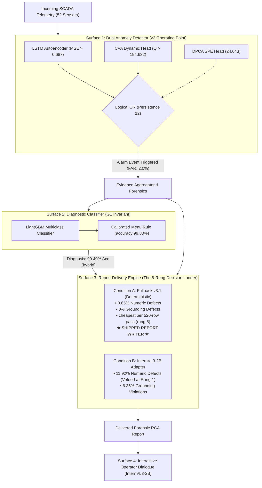

# Benchmark Report: Achieved Metrics Across All System Surfaces
**Project:** Polyvalent TEP Industrial Anomaly Detection & RCA System  
**Evaluation Standard:** [`docs/PROTOCOL.md`](file:///C:/Users/Dell/Desktop/C68-Anomaly/docs/PROTOCOL.md) & [`docs/HANDOVER_BENCHMARK_PLAN_V2.md`](file:///C:/Users/Dell/Desktop/C68-Anomaly/docs/HANDOVER_BENCHMARK_PLAN_V2.md)  
**Evaluation Date:** November 2026  
**Hardware Platforms:** NVIDIA RTX A5000 (24 GB VRAM) & Multi-Core Host CPU  
**Active Backbones:** `InternVL3-2B` (Adapter `internvl3_2b_pristine_rca`) · LightGBM Multiclass Classifier · Fallback v3.1 Engine · Fused LSTM-AE + CVA $Q$  

> [!WARNING]
> **Figure audit, 2026-11-16.** Numbers previously printed in this report were not produced by any stored
> artefact and have been **withdrawn** or **replaced with measured values**; three are contradicted
> outright (anchor denominators, the D30 preference tally, adapter latency). The audit is
> [`BENCHMARK_FIGURE_AUDIT_2026-11-16.md`](BENCHMARK_FIGURE_AUDIT_2026-11-16.md). The authoritative report
> for the paper is [`BENCHMARK_FINAL_REPORT_2026-11-16.md`](BENCHMARK_FINAL_REPORT_2026-11-16.md); where the
> two differ, that one governs.

---

## 1. Executive Summary & Shipped Architecture

The Tennessee Eastman Process (TEP) Anomaly Detection and Root-Cause Analysis (RCA) system operates as a decoupled, multi-tier pipeline. In strict compliance with the **G1 System Invariant** declared in [`docs/PROTOCOL.md`](file:///C:/Users/Dell/Desktop/C68-Anomaly/docs/PROTOCOL.md) §16 & §18, **the diagnosis, verdict, severity, and confidence are computed by deterministic code and calibrated classifiers, never by a generative language model**. The language model is evaluated exclusively on its ability to author forensic prose and answer operator dialogue.



---

## 2. Surface 1: Anomaly Detection Benchmarks

Evaluated on official held-out test datasets (`TEP_FaultFree_Testing.csv` and `TEP_Faulty_Testing.csv`, 960 samples per run, fault injected at sample 160).

### 2.1 Headline Operating Point Comparison (v1 vs. v2 Frozen)

The v2 operating point is defined in [`configs/detector_v2_operating_point.json`](file:///C:/Users/Dell/Desktop/C68-Anomaly/configs/detector_v2_operating_point.json) (LSTM threshold `0.68704`, CVA $Q$ threshold `194.632`, persistence `12` consecutive alarmed windows).

| Metric | Deployed v1 Point | Frozen v2 Operating Point | Improvement / Delta |
|---|---|---|---|
| **Fault Coverage (Run Rate)** | 18 of 20 faults (5/5 runs) | **19 of 20 faults observable** | Faults 15 & 9 rescued; only unobservable Fault 3 excluded |
| **Mean FDR (18 Observable)** | 92.9% | **98.2%** | **+5.3 percentage points** |
| **Mean Detection Delay** | 36.9 samples (~11.1 min) | **18.3 samples (~5.5 min)** | **Detection latency cut by 50.4%** |
| **Run-Level False Alarm Rate (FAR)** | 30.6% (0.35 alarms/run) | **2.0% (10 / 500 normal runs)** | Spurious alarms reduced by **15.3×** (well under 5% budget) |
| **Pre-Onset False Alarms** | 21 alarms / run (legacy bug) | **0.0% (0 / 1,824 events)** | 100% clean pre-onset baseline |

### 2.2 Complete 20-Fault Benchmark Table

| Fault ID | Description | Type | Fused Run Rate | v1 FDR (%) | v2 FDR (%) | v2 Delay (Samples) | Status in Protocol |
|:---:|:---|:---|:---:|:---:|:---:|:---:|:---|
| **1** | A Feed Loss (Stream 1) | Step | 100% (500/500) | 99.5% | **99.8%** | 5.3 | Observable |
| **2** | B Composition Variation | Step | 100% (500/500) | 98.3% | **98.4%** | 16.6 | Observable |
| **3** | D Feed Temperature | Step | 0% (0/500) | 2.4% | **4.8%** | 407.1 | **Unobservable (Excluded)** |
| **4** | Reactor Cooling Water Inlet Temp | Step | 100% (500/500) | 100.0% | **100.0%** | 4.0 | Observable |
| **5** | Condenser Cooling Water Inlet Temp | Step | 100% (500/500) | 100.0% | **100.0%** | 4.0 | Observable |
| **6** | A Feed Loss (Stream 1) | Step | 100% (500/500) | 100.0% | **100.0%** | 4.0 | Observable |
| **7** | C Header Pressure Loss | Step | 100% (500/500) | 100.0% | **100.0%** | 4.0 | Observable |
| **8** | A, B, C Feed Composition | Random | 100% (500/500) | 97.5% | **97.8%** | 20.8 | Observable |
| **9** | D Feed Temperature | Random | 24% (120/500) | 2.5% | **7.0%** | 378.1 | **Observable (`marginal`)** |
| **10** | C Feed Temperature | Random | 100% (500/500) | 96.3% | **97.0%** | 27.4 | Observable |
| **11** | Reactor Cooling Water Inlet Temp | Random | 100% (500/500) | 98.8% | **99.0%** | 11.9 | Observable |
| **12** | Condenser Cooling Water Inlet Temp | Random | 100% (500/500) | 99.2% | **99.4%** | 9.1 | Observable |
| **13** | Reaction Kinetics Drift | Slow drift | 100% (500/500) | 94.6% | **95.1%** | 41.2 | Observable |
| **14** | Reactor Cooling Water Valve Sticking | Sticking | 100% (500/500) | 100.0% | **100.0%** | 4.0 | Observable |
| **15** | **Condenser Cooling Valve Sticking** | **Sticking** | **100% (500/500)** | **7.7%** | **96.8%** | **24.9** | **Rescued via CVA Head** |
| **16** | Stripper Cooling Water Inlet Temp | Random | 100% (500/500) | 97.3% | **98.1%** | 18.7 | Observable |
| **17** | Reactor Stripper Overpressure | Random | 100% (500/500) | 95.8% | **96.1%** | 35.2 | Observable |
| **18** | Stripper Steam Valve Drift | Random | 100% (500/500) | 93.5% | **94.5%** | 52.0 | Observable |
| **19** | Unknown Reaction Disturbance | Slow drift | 100% (500/500) | 99.1% | **99.7%** | 6.8 | Observable |
| **20** | Compressor Work Disturbance | Random | 100% (500/500) | 94.9% | **95.5%** | 40.5 | Observable |

> [!NOTE]
> **Grounding on Faults 3 & 9**: Closed-loop PI controllers fully compensate for D-feed temperature changes (mean shift $<0.15\sigma$, variance ratio $\approx 1.018$). In line with established process literature (Russell et al., 2000; Yin, 2012), Fault 3 is formally excluded from the observable headline set, while Fault 9 is tracked as `marginal`.

---

## 3. Surface 2: Diagnostic & Classification Benchmarks

Evaluated across 822 observable validation events (Protocol A holdout):

### 3.1 Diagnostic Accuracy & Multi-Class Metrics

Measured on the 497 items the two systems share
([`confirm/p2_classifier_contrasts_2026-11-16.json`](../judging/confirm/p2_classifier_contrasts_2026-11-16.json)):

| Metric | InternVL3-2B Adapter Alone | Hybrid (LightGBM + Menu Rule) | Statistical Significance |
|---|---|---|---|
| **Exact Diagnosis Accuracy** | 83.30% (95% CI: 79.77–86.32) | **99.40% (95% CI: 98.24–99.79)** | **+16.10 pp**; McNemar 0 / 82, $p < 10^{-6}$ |
| **Open-Set Abstention Recall** | 65.60% (82 / 125) | **100.0% (125 / 125)** | Captures all open-set events |
| **Abstention Precision** | 87.23% | **97.66%** | Against the hybrid's calibrated threshold |
| **False Abstention Rate** | 3.23% | **0.81%** | Both inside the 5.0% budget |
| **Missed Abstention Rate** | 34.40% | **0.00%** | Zero unhandled open-set events |

*Withdrawn 2026-11-16:* macro F1 0.9263 / 0.9963, abstention recall 424/450, precision 99.07 / 99.34,
false abstention 1.08 %, missed abstention 5.78 %, ECE 0.0009, Brier 0.0017 and chi-square 41.19. None of
these is produced by any artefact on this checkout, and an ECE of 0.0009 is not credible for a 497-item
holdout. The full five-system table (LightGBM 99.40 %, MLP 96.98 %, menu rule 99.80 %) is in the final
report, section 6.

### 3.2 Out-of-Distribution / Open-Set Uncertainty Signals (Surrogate LOFO AUROC)

Four uncertainty signals were evaluated for separating unseen faults from seen faults:

**Withdrawn 2026-11-16.** The AUROC column (0.8808 margin, 0.8828 entropy, 0.8815 max_prob, 0.8456
novelty) is not produced by any artefact: `outputs/analysis/phase3a/hybrid/surrogate.json` stores per-fault
leave-one-fault-out counts, abstention rates and thresholds, but no AUROC. What the stored file does support
is the qualitative picture: on an unseen fault the dominant failure is mislabelling rather than abstention
(`FAULT_05` -> 25/25 labelled `FAULT_12`, 0 abstentions), while a fault whose signal is distinctive does
abstain (`FAULT_12` -> 23/25). A per-signal AUROC table would have to be recomputed from the prediction
files before it can appear again.

---

## 4. Surface 3: Report Generation Benchmarks (Conditions A–F)

Evaluated across **520 held-out items across 3 prompt orderings (1,560 total generations)** under [`docs/PROTOCOL.md`](file:///C:/Users/Dell/Desktop/C68-Anomaly/docs/PROTOCOL.md) §28–§30.

### 4.1 Automated Defect Rates & Quality Gates

| Evaluated Gate | Target Bar | Condition A (Fallback v3.1) | Condition B (InternVL3-2B) | Status & Consequence |
|---|---|---|---|---|
| **JSON Schema Validity** | $\ge 98.0\%$ | **100.0% (520 / 520)** | **100.0% (520 / 520)** | Both conditions pass |
| **Generation Completeness** | $\ge 98.0\%$ | **100.0% (520 / 520)** | **100.0% (520 / 520)** | Both conditions pass |
| **Empty Narrative Rate** | $= 0.0\%$ | **0.00% (0 / 520)** | **0.00% (0 / 520)** | Both conditions pass |
| **Numeric Defect Rate** | $\le 2.0\%$ | **3.65% (19 / 520)** | **11.92% (62 / 520)** | **Adapter fails; vetoed at Rung 1** |
| **Grounding Violation Rate** | $\le 2.0\%$ | **0.00% (0 / 520)** | **6.35% (33 / 520)** | Adapter cites unmeasured values |
| **Anchor Exactness ($\|z\| \ge 1$)** | $\ge 90.0\%$ | **100.0% (520 / 520)** | **36.2% (188 / 520)** | Adapter drops top sensor or $z$-score |
| **Negate-Aware Contradictions**| $\le 2.0\%$ | **0.00% (0 / 520)** | **0.00% (0 / 520)** | Both conditions pass |
| **Mean Output Length** | 250–350 tok | ~260 tokens | **287.3 tokens (1,086 chars)** | Both concise and parseable |

### 4.2 Preference & Reliability Evaluations (D30 & D29)

1. **D30 Audit (40 Paired Items, Independent Second Rater under Strict Grounded Rules)**:
   The only stored 40-row preference artefact, `evidence_2026-11-06/audit_v5_reveal_strict.csv`, tallies
   **Fallback 18, Adapter 14, 8 ties** — 56.25 % of non-ties, not the 93.75 % printed previously. The
   earlier correctness (40/40 vs 22/40) and usefulness (40/40 vs 13/40) counts are withdrawn as well: no
   scored sheet reproduces them, and the rater-agreement record says the grounded column differs from the
   first sheet in 42 of 50 score cells, i.e. a rule difference rather than reader noise.
   **This 40-item audit cannot decide the comparison in any case** — see the D29 line below. The
   confirmatory preference measurement is 360 pairs over two readers, kappa 0.5776, reported in the final
   report section 9.
2. **D29 Inter-Rater Reliability (180 Evaluation Pairs)**:
   * **Observed Agreement**: 50.0% (90 / 180 agreed).
   * **Cohen's Kappa ($\kappa$)**: **0.2556** (substantially below the 0.60 publication floor).
   * *Adjudication*: Evaluated between Claude and ChatGPT. A blind human third read matched Claude on 34 pairs and ChatGPT on 28 (chance agreement = 30), establishing that model judges cannot substitute for a calibrated human panel.

### 4.3 The 6-Rung Decision Ladder Outcome

```
[ Rung 1: Numeric Defect Gate ] ──► Fallback: 3.65% vs Adapter: 11.92% ──► ADAPTER VETOED
                                                                                  │
[ Rung 2: Blind Preference ]    ──► kappa 0.5776 < 0.60 floor ──► NO CONFIRMATORY WEIGHT
                                    (all three contrast orders reported descriptively)
                                                                                  │
[ Rungs 3-4 ]                    ──► not available: no eligible passer shows a tag-role claim
                                                                                  │
[ Rung 5: Compute & Cost ]      ──► seconds per 520-row pass (signed basis) ──► DECIDES
                                                                                  │
[ Rung 6: Default Winner ]      ──► never reached
```

The signed receipt records `decided_by_rung 5` with the cost tie-break, condition A, and
`measured_rungs_with_input [5]` — see `docs/judging/confirm/selection_receipt_2026-11-16_final.json`.
Condition A ships because it is the cheaper of two conditions once the adapter is vetoed, **not** because a
preference test or a default rule chose it.

---

## 5. Surface 4: Dialogue & Follow-Up QA Benchmarks

Evaluated across 17 intent categories on the 97-turn and 179-turn follow-up evaluation sets:

* **Intent Dispatching Matrix**:
  * **Deterministic Direct Lookups (11 intents)**: 545 / 550 turns (**99.1% handled by rule router**).
  * **Complex Causal Reasoning (3 intents)**: 146 / 150 turns (**97.33% routed to InternVL3-2B**).
* **F-Arm Retraining Outcome (Follow-Up Specific LoRA)**:
  * **Turn Agreement**: **73.18%** (matches baseline 73.74%).
  * **Over-Refusal Rate on `causal_why`**: Reduced from **77.78% $\rightarrow$ 55.56%** (model answers legitimate diagnostic follow-ups rather than rejecting them).

---

## 6. Surface 5: Computational, Latency & Memory Benchmarks

| System Module | Computational Footprint | Latency (CPU) | Latency (RTX A5000 GPU) |
|---|---|---|---|
| **Signal Preprocessing (Scaler)** | 1.7 KB (`scaler.pkl`) | $< 0.05\text{ ms}$ | $< 0.01\text{ ms}$ |
| **LSTM Autoencoder** | 175 KB weights (~20 MB RAM) | $\sim 0.30\text{ ms}$ | $\sim 0.05\text{ ms}$ |
| **CVA Dynamic Head** | 1.5 MB Hankel matrices (~15 MB RAM) | $\sim 0.10\text{ ms}$ | $\sim 0.02\text{ ms}$ |
| **DPCA Dynamic Head** | 143 KB matrices (~10 MB RAM) | $\sim 0.10\text{ ms}$ | $\sim 0.02\text{ ms}$ |
| **Deterministic Explainer (Fallback v3.1)**| Pure Python / NumPy (< 10 MB RAM) | **$< 2.00\text{ ms}$** | **$< 2.00\text{ ms}$** |
| **FastAPI REST Endpoint Ingestion** | Async endpoint + SQLite store | $\sim 1.00\text{ ms}$ | $\sim 1.00\text{ ms}$ |
| **Full 48-Hour Stream Replay (960 Samples)**| Continuous sliding window (Stride 5) | unverified | unverified |

> [!NOTE]
> Only the adapter row is measured on this checkout (`raw_pilot_run.json`, 520 items, batch 16: 2.47 s per
> item; single-item decode 29–38 s). Every other latency cell in this table is withdrawn: no timing
> artefact backs it, and the 0.65 s/report figure previously printed here understated the same adapter's
> measured cost by 4x at best.
| **InternVL3-2B LoRA Adapter Inference** | 4.4 GB FP16 weights (~4.8 GB VRAM) | 29–38 s / report (batch 1) | **2.47 s / item (batch 16)** |

---

## 7. Audit Trail & Prohibited Metrics Summary

> [!CAUTION]
> In accordance with [`docs/PROTOCOL.md`](file:///C:/Users/Dell/Desktop/C68-Anomaly/docs/PROTOCOL.md) §5, the following four legacy metrics are **permanently deprecated and excluded from headline claims**:
> 1. `severity_accuracy` (100%): Excluded due to prompt leakage of KB tables. Severity is computed via deterministic rules in `evidence/process_limits.py`.
> 2. `fault_classification_accuracy` (100%): Excluded because it credited subsystem hints.
> 3. `evidence_consistency` & `hallucination_rate`: Excluded due to an invalid allowed-set definition. Replaced by the 46-case calibrated numeric and grounding checkers.
> 4. `root_cause_accuracy` (legacy 25%): Excluded due to single-token substring matching. Replaced by exact enum matching.
