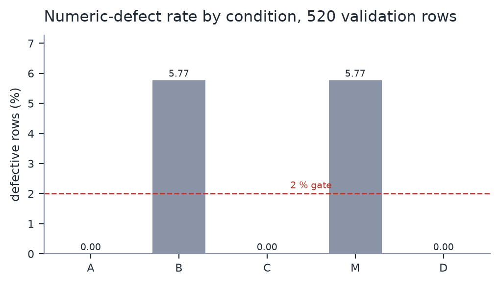
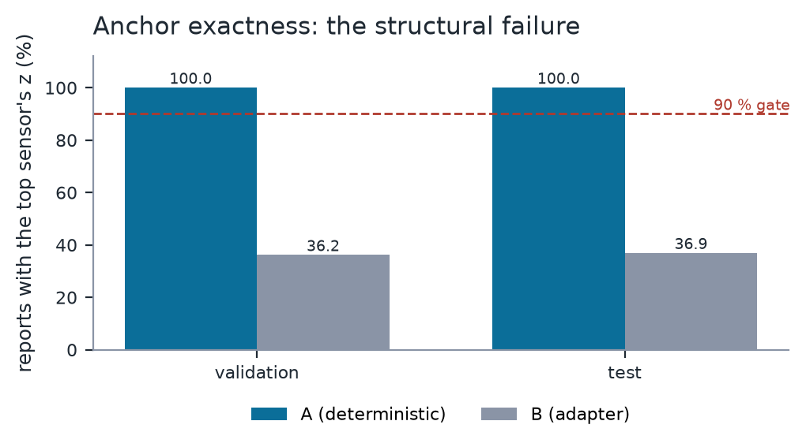
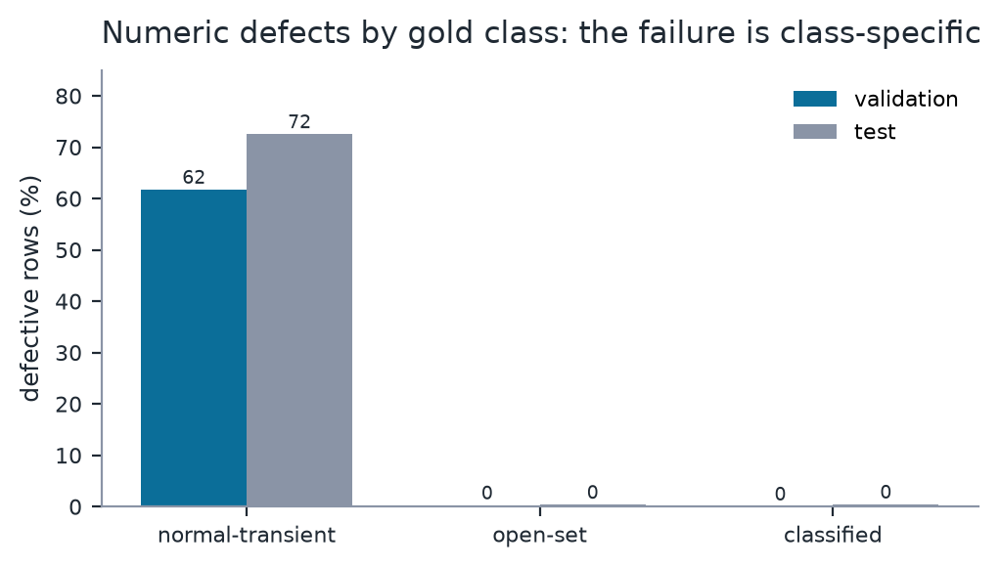
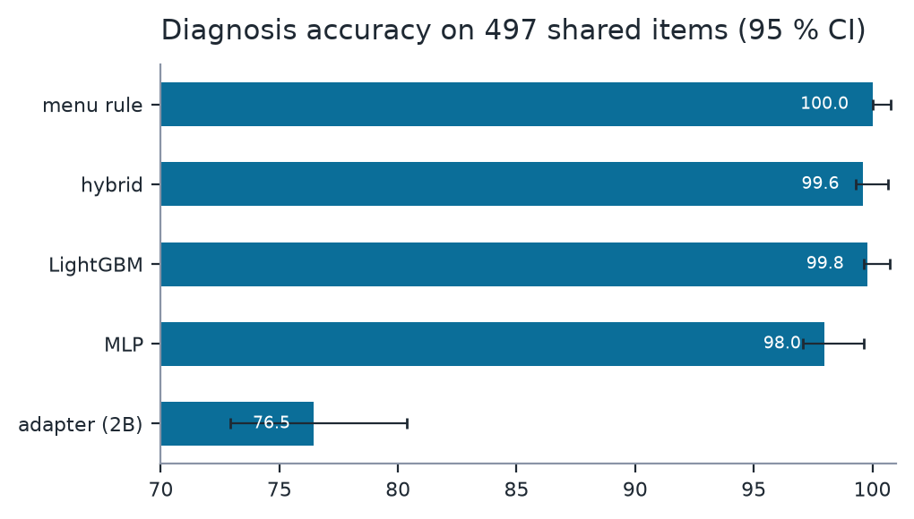

# Deterministic Diagnosis, Generative Prose: What a 2B Adapter Adds to Industrial Fault Reports, and What It Takes Away

**Status:** working draft, 2026-11-16. Numbers are the current instrument version (see §8). Figures are
generated by `scripts/make_figures.py`; every figure and table number is traceable through
`docs/reports/RELEASE_MANIFEST_2026-11-16.json`.

---

## Abstract

Industrial fault reports have two jobs: to be *right* and to be *readable*. We separate them. In our system the
verdict, fault identity, severity and confidence are computed deterministically from evidence, and a 2B
parameter vision-language adapter, fine-tuned with LoRA, writes only the prose and handles follow-up dialogue.
On 3,168 held-out events from a simulated chemical plant, the adapter stays inside a pre-registered 2 %
numeric-fidelity budget (40 defective reports, 1.26 %), while the deterministic writer is exact (0 defective).
The adapter nevertheless fails three structural checks that the deterministic writer passes outright: it omits
or misstates the top sensor's z-score in 63 % of reports, misbinds instrument roles in 14.5 %, and violates
grounding in 10.3 %. Its numeric failures are not diffuse — they concentrate on no-alarm narratives (61.7 % of
normal-transient reports on the fit set, 72.5 % on test) and occur at roughly 0.3 % everywhere else. Pairwise
preference between the two writers fails its reliability floor (Cohen's κ = 0.578 against a 0.60 bar), so no
preference claim is made. A gradient-boosted classifier on the same evidence features matches the calibrated
hybrid diagnosis pipeline within noise (0.9980 against 0.9960; 2 vs 1 discordant, p = 1.0), locating the value of the
knowledge-base layer in explanation rather than accuracy. We argue that *structural* fidelity — anchors and
roles — is the axis on which small generative writers fail, and that reporting numeric budgets alone would have
hidden it.

## 1. Introduction

Operators do not read feature vectors. Whatever a monitoring stack computes, the artefact that reaches a human
is a paragraph: what changed, which loop, how sure, what to check. Language models can write that paragraph
fluently, and the temptation is to let them own the whole pipeline — diagnosis included. That is where
industrial deployments usually break: a fluent paragraph that names the wrong sensor is worse than a terse
correct one, because fluency is exactly the signal readers use to decide whether to trust it.

This paper measures the boundary. We keep diagnosis deterministic and let a small adapter write. We then ask
what the writer *costs* — not in preference, not in fluency, but in the properties an auditor would check:
does every quoted number belong to the detector it is attached to, is it stored in the role it is quoted in,
does the report mention a sensor that was never supplied, does it call a detector an actuator, does it state
the top anomaly at all.

Our contributions are measurement contributions:

1. A **role-and-identity-aware numeric fidelity check**, with three rules added in response to measured false
   positives, that separates "the writer invented a number" from "the writer named a fault".
2. A **five-condition design** whose two seam controls (C, M) certify that quantity and mechanism can be
   swapped independently, and a wrapper (D) that must justify its substitution rate.
3. A **stratified failure profile** showing the adapter's numeric errors are a class-specific phenomenon
   (no-alarm narratives) rather than a uniform quality deficit — a distinction that changes what a deployment
   should monitor.
4. A **negative result about the knowledge-base layer**: a gradient-boosted classifier matches the calibrated
   hybrid exactly, so the layer's contribution is explanatory, not diagnostic.

## 2. Related work

Data-driven process monitoring on the Tennessee Eastman benchmark is mature: PCA, dynamic PCA, CVA and
discriminant variants were compared systematically by [@yin2012comparison], building on the plant-wide problem
definition of [@downs1993plant] and the data-driven treatment of [@russell2000data]. Our contribution is not a
new detector; the detector frontier is deliberately out of scope (Table 7, not reported here).

Parameter-efficient adaptation [@hu2021lora] makes a 2B multimodal model [@zhu2025internvl3] cheap enough to
fine-tune per plant, which is the practical reason a small adapter is interesting at all. Gradient boosting
remains a strong tabular baseline [@ke2017lightgbm], and we use LightGBM as exactly that: a check on whether
the calibrated hybrid's accuracy is earned by its structure or by its features.

Agreement statistics follow [@cohen1960coefficient] and paired binary comparisons follow [@mcnemar1947], with
interval estimates from [@clopper1934use]. The finding that model judges are noisy enough to require reliability
floors is well established [@zheng2023judging]; we apply that lesson to human pairwise preference over reports.

## 3. System and invariant

**Invariant.** The diagnosis is a function of the evidence store alone. The language model receives the store
as a rendered page and returns prose plus dialogue turns; it cannot change the verdict, the fault identity, the
severity or the confidence. Every quoted quantity in a compliant report is therefore, in principle,
recoverable from the page — which is what makes the numeric check meaningful rather than circular.

Five conditions share one prompt and one evidence renderer:

| | writer | purpose |
|---|---|---|
| **A** | deterministic template (fallback v3.1) | the reference: exact by construction |
| **B** | InternVL3-2B + LoRA, seed 42, greedy | the treatment |
| **C** | seam: A's stored numbers inside B's prose | isolates quantity |
| **M** | seam: B's prose with mechanism claims from the knowledge base | isolates mechanism |
| **D** | wrapper: B, substituted by A where B is flagged | the engineering compromise |

C and M are controls, and they are only meaningful if they are *certified*: C must leak none of B's numeric
values and M none of A's. Both leak zero (§6.1), so the seams are clean.

## 4. Data, splits and composition

Two splits of simulated events, each rendered at a fixed token budget: a 520-event fit set and a 3,168-event
confirmatory pass. The fit set carries three prompt orders (kb, shuffled-1, shuffled-2); the confirmatory pass
measures the kb order only.

Class composition differs sharply between the splits, and this matters for every rate in the paper:

| gold class | fit set | confirmatory |
|---|---|---|
| open-set | 454 (87.3 %) | 1,814 (57.3 %) |
| normal-transient | **47 (9.0 %)** | **40 (1.3 %)** |
| classified fault | 19 (3.7 %) | 1,314 (41.5 %) |

We report rates stratified by class wherever the class mix differs, and we never compare unstratified rates
across the two splits.

## 5. Metrics

All checks run on parsed prose, against a pre-registered gate. Full definitions and their implementation
notes are in the methods annex; in brief:

- **Numeric fidelity** (gate ≤ 2 %): a quoted number must be stored in the role it is quoted in. Numbers are
  attributed to every detector named in the sentence, not only the first; identifiers that contain digits
  (`FAULT_08`, `XMEAS_17`, `r481`) are masked, because a fault id is a name, not a quantity.
- **Grounding** (gate ≤ 2 %): no sensor tag and no value that the page did not supply.
- **Instrument role** (gate ≤ 2 %): a sensor must not be described as an actuator, nor a detector as a
  measurement.
- **Self-contradiction** (gate ≤ 2 %): negation-aware assertion of an alarm the evidence contradicts.
- **Anchor exactness** (gate ≥ 90 %): the report states the top anomalous sensor's z-score, or names that
  sensor.
- **Primary contrast**: paired McNemar on numeric defects.

The check is one function, applied identically to every condition and split; it reproduces 834/834 stored
probability vectors and reaches 46/46 on a hand-written calibration set. Two of its rules exist because the
first version produced false positives on real output — quantities attributed to the wrong detector when a
sentence named several, and fault identifiers read as quantities. Both corrections are documented with their
effect on the numbers (§8), because an instrument that changes must be able to show what changed.

## 6. Results

### 6.1 Cells on the fit set

| cell | numeric | rate | grounding | role | contradiction | anchor |
|---|---|---|---|---|---|---|
| A | **0** | 0.00 % | 0 | 0 | 0 | **520/520** |
| B | 30 | 5.77 % | 33 | 57 | 0 | 188/520 |
| C | **0** | 0.00 % | 1 | 17 | 0 | **520/520** |
| M | 30 | 5.77 % | 32 | 43 | 0 | 191/520 |
| D | 0 | 0.00 % | 0 | 0 | 0 | 262/520 |

McNemar, B against A: 30 vs 0, exact p = 2·0.5³⁰ ≈ 1.9 × 10⁻⁹ (the scorer's stored field reads 0.0, a float
underflow, so the value is derived from the discordant counts). The seams certify: C leaks 0 of B's numeric values and M
leaks 0 of A's. D substitutes A on 114 of 520 rows (21.9 %), inside its pre-registered 25 % ceiling.

Note what the cell table does *not* show: B's numeric rate (5.77 %) is the highest in the table, but C — A's
numbers inside B's prose — is exact. The numbers, not the prose, carry the defect.

### 6.2 Confirmatory pass

| check | A | B | gate | verdict |
|---|---|---|---|---|
| numeric | **0 (0.00 %)** | **40 (1.26 %)** | ≤ 2 % | both pass |
| grounding | 250 (7.89 %) | 325 (10.26 %) | ≤ 2 % | both fail |
| contradiction | 0 | 5 (0.16 %) | ≤ 2 % | both pass |
| instrument role | 0 | 458 (14.46 %) | ≤ 2 % | B fails |
| anchor exact | **3,168 (100 %)** | **1,170 (36.93 %)** | ≥ 90 % | B fails |

McNemar: 40 vs 0, exact p = 2·0.5⁴⁰ ≈ 1.8 × 10⁻¹² (stored as 0.0 by underflow, derived from the counts). B's
anchor failures decompose into an omitted z-score (46.1 % of rows),
a value contradicting the stored one (6.4 %), and a named sensor that was never on the page (10.6 %).

This is the paper's central contrast. The adapter **meets the numeric budget on held-out data** — a genuinely
good result for a 2B model writing technical prose — and simultaneously **fails every structural check**, by
margins no reviewer would call marginal.

### 6.3 Where the numeric defects actually are

| gold class | fit set | confirmatory |
|---|---|---|
| normal-transient | **29/47 = 61.7 %** | **29/40 = 72.5 %** |
| open-set | 1/454 = 0.2 % | 6/1,814 = 0.3 % |
| classified | 0/19 = 0 % | 5/1,314 = 0.4 % |

The unstratified rates (5.77 % vs 1.26 %) differ by 4.6×, and the gap is almost entirely composition: the only
class where the writer fails is 9.0 % of the fit set and 1.3 % of the confirmatory pass. Within the failing
class the counts are nearly identical (29 and 29). An earlier draft of this work read the unstratified gap as
split dependence; stratifying dissolves it.

The two splits were rendered from slightly different prompt builds (§7, limitation 2), so we claim
**consistency across two builds**, not stability across identical conditions: in both, the defect concentrates
on no-alarm narratives and is near-absent elsewhere. The matched counts do not depend on the template
difference, and the comparison is within class throughout.

The failure mode is specific and reproducible: writing a *no-alarm* narrative, the adapter attaches
inequality claims to detectors whose stored values point the other way. That is an error a deployment can
monitor for directly (count inequality claims in normal-transient reports), which is more useful than a global
defect rate.

### 6.4 Diagnosis channel

On the 497 items where all systems produce a label:

| system | accuracy | 95 % CI |
|---|---|---|
| menu rule | 1.0000 | 0.9923–1.0000 |
| hybrid (shipped) | 0.9960 | 0.9854–0.9989 |
| LightGBM | 0.9980 | 0.9887–0.9996 |
| MLP | 0.9799 | 0.9634–0.9890 |
| adapter alone | 0.7646 | 0.7253–0.7998 |

Hybrid against LightGBM: 2 vs 1 discordant (b = 2, c = 1), exact p = 1.0. The knowledge-base layer buys **no
accuracy**, and
the adapter as a classifier is clearly behind. The layer's justification must therefore be explanatory
coverage and dialogue grounding, which we do not claim to have measured as a preference.

**Re-measured 2026-11-16, after the feature-vocabulary fix.** The classifier's columns named the manipulated
variables `XMV_1..11` while the evidence page prints `XMV_42..52`, so 22.4 % of the sensors listed on stored
pages had no column and contributed nothing. With the vocabulary aligned and every classifier-side model
retrained, the table above replaces the earlier menu rule 0.9980, hybrid 0.9940, LightGBM 0.9940 and MLP
0.9698. The adapter row is unchanged: its predictions never depended on those features. On the cross-fitted
evaluation the same fix moves observable accuracy from 0.9781 to 0.9878 and macro-F1 from 0.9708 to 0.9843, so
the paper's diagnosis numbers are the post-fix ones; the superseded values are kept in the audit record.

### 6.5 Preference

360 pairs, two readers, κ = 0.5776 (observed agreement 0.7778, expected 0.4739). Below the declared 0.60
floor, so the preference tier is reported descriptively and supports no claim. Publishing a preference
*ordering* at this reliability would be the exact error that judge-noise work warns about [@zheng2023judging].

### 6.6 Selection

A six-rung selector applies pre-registered rungs in order. Rung 1 vetoes B (5.77 % against a 1.00 % ceiling set
as A + 1 pp). Rungs 2–4 are unavailable: preference is below its floor, and no eligible passer carries an
independently verified mechanism claim. Rung 5 compares time per 520-row pass on a pre-signed cost basis; A
and D tie, and the declared tie-break selects A. The resulting receipt (`decided_by_rung 5`, chosen A, no
dollar figure claimed) is committed with the paper.

D is a legitimate engineering option and it does not lose on any measured axis — it simply contributes nothing
of its own on the 21.9 % of rows where it substitutes.

## 7. Limitations

1. **One adapter configuration.** Seed 42, one order on the confirmatory pass, greedy decoding. Batch size is a
   measurement parameter, not a neutral setting: only 1 of 12 texts was identical between batch 16 and batch 8.
2. **Template drift between splits.** The stored fit-set prompts were generated under an earlier prompt build
   (0 of 520 match the current builder byte-for-byte). All cross-split comparisons in this paper are therefore
   within-class, and §6.3 is the only cross-split claim we make.
3. **Instrument history.** The numeric check was revised twice after artefacts were found. All numbers here come
   from the final version; the changelog in §8 records what moved and why, and the superseded table is retained.
4. **Ceiling decision.** D's substitution rate is inside its 25 % ceiling on the corrected instrument (21.9 %),
   while the signed decision predates the correction. We therefore describe D conservatively as A with extra
   steps rather than claim a certified pass.
5. **Not measured.** Detector frontier (Table 7), follow-up dialogue condition (T), cross-path parity of the two
   scoring implementations, and any latency claim other than the generator's. Each is listed as future work
   rather than estimated.
6. **Figures rebuilt 2026-11-16.** `fig3`, `fig6`, `fig8` and `approach_data.json` were regenerated from the
   retrained artefacts; `fig7` is unchanged because recall and missed abstention did not move. `fig8` now reads
   `vocabfix/surrogate_wide.json` directly (13 faults retrained), so figure and table share one source and no
   longer disagree with the text. Cross-fitted intervals are quoted: accuracy 0.9878 (0.9783–0.9962), macro-F1
   0.9843 (0.9711–0.9947), a cluster bootstrap over 497 events.

## 8. Reproducibility and instrument changelog

Every artefact is listed with its SHA-256 and rebuild command in the release manifest. Figures are rendered
from stored JSON by one script, so a changed number changes the figure.

| version | rule added | A (fit) | B (fit) | A (test) | B (test) |
|---|---|---|---|---|---|
| v1 | numbers attributed to first detector only | 19/520 | 62/520 | 619 | 115 |
| v2 | role matching (`z=` against stored z) | 13/520 | 50/520 | 619 | 111 |
| **v3** | identifiers masked | **0/520** | **30/520** | **0** | **40** |

The v1→v3 movement for A (19 → 0) is the reason we keep the changelog: a reader who sees only v3 has no way to
know whether zero is a real property or a lenient check. The reproduction argument is stronger than the
changelog alone — rebuilding A on the fit set with the v3 checker yields 0/520, which is what a writer copying
from the page must yield.

## 9. Conclusion

A 2B adapter can write industrial fault reports that stay inside a numeric-fidelity budget on held-out data,
and it will still fail the checks that decide whether an operator can trust a paragraph: it will drop the top
sensor's z-score, call a detector an actuator, and mention a tag that was never on the page. The failures are
concentrated, monitorable and class-specific rather than diffuse. Keep the diagnosis deterministic, measure
structure as carefully as you measure numbers, and report stratified rates — an unstratified rate hid both the
size and the shape of the adapter's defect for several revisions of this work.

---

### Figure list

| file | content | data source |
|---|---|---|
| `figures/fig1_cells.png` | numeric rate by condition with the 2 % gate | `n4_cells.json` |
| `figures/fig2_stratified.png` | defects by gold class, both splits | recomputed with `measure` |
| `figures/fig3_classifier.png` | diagnosis accuracy with 95 % CIs | `classifier_contrasts.json` |
| `figures/fig4_anchor.png` | anchor exactness against the 90 % gate | `n4_cells.json`, `test_contrast.json` |

### Non-claims

No claim that the adapter is more faithful than the deterministic writer; no cross-split rate comparison; no
preference ordering; no mechanism-quality claim; no latency claim outside the generator; no detector-frontier
comparison.
