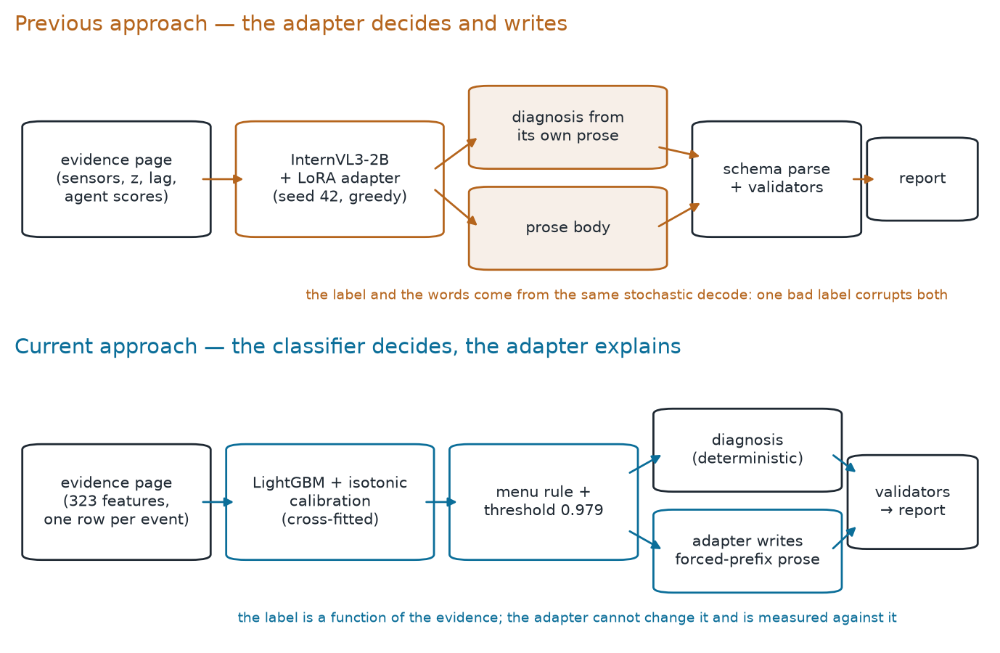
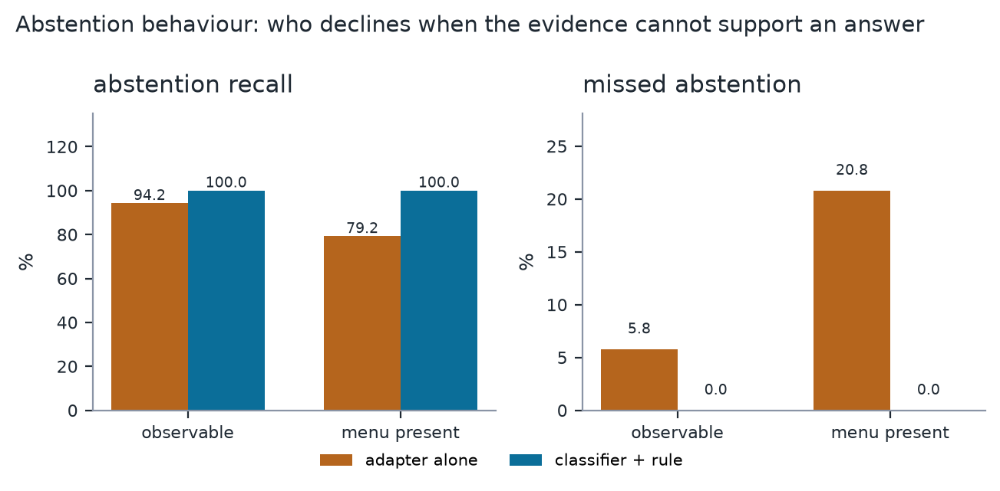
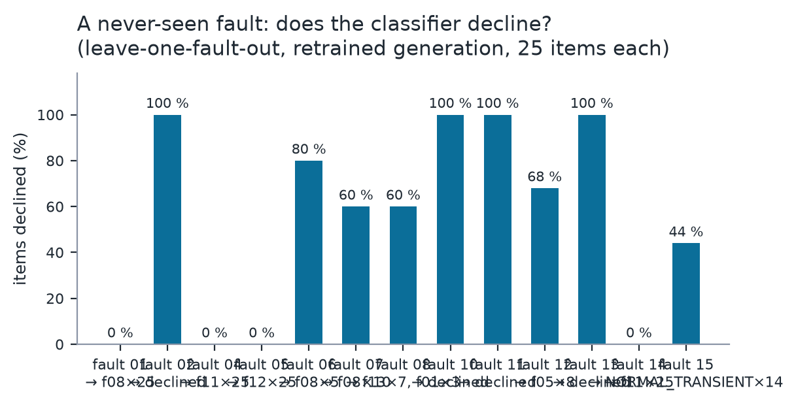
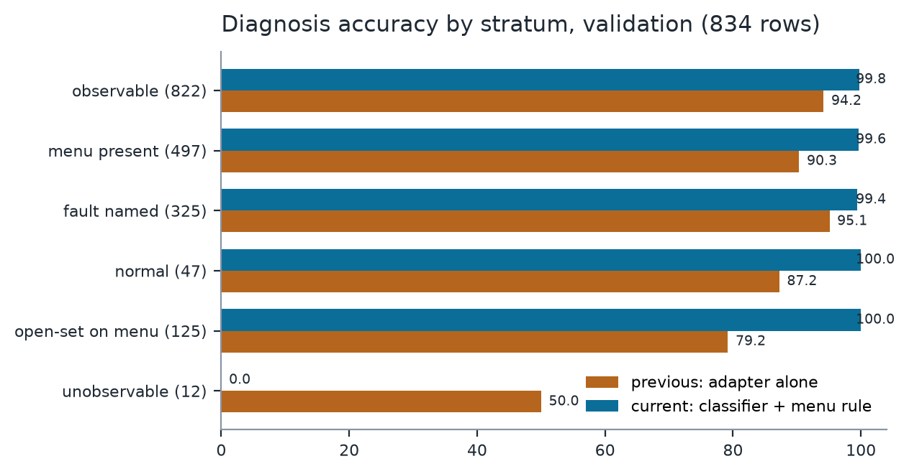
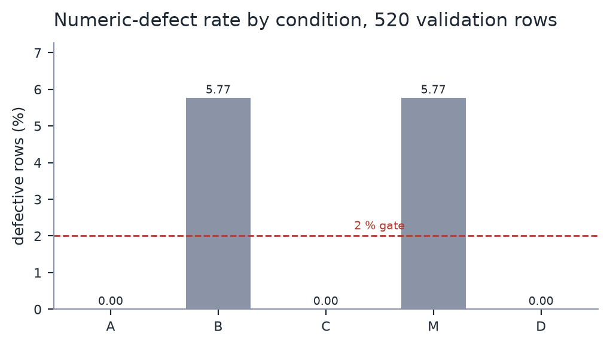
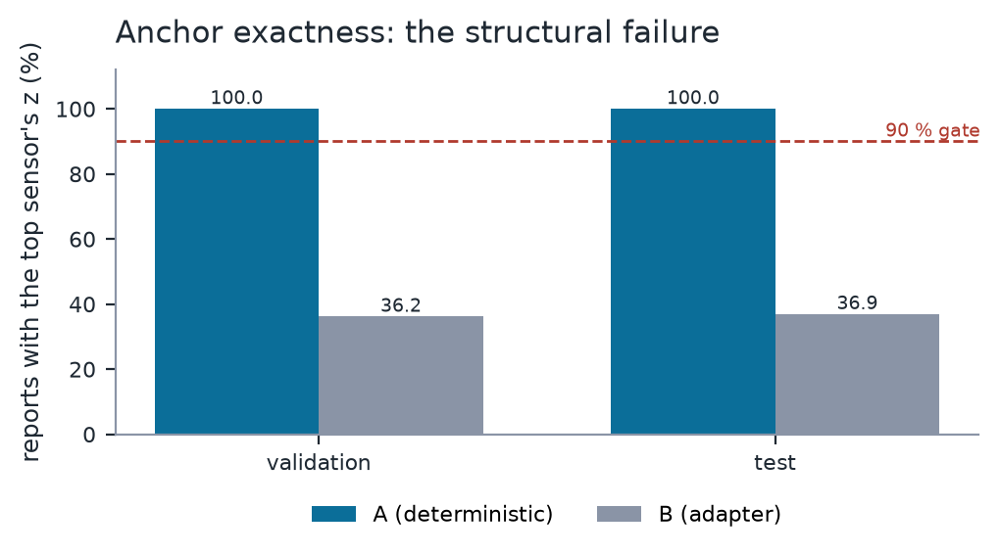
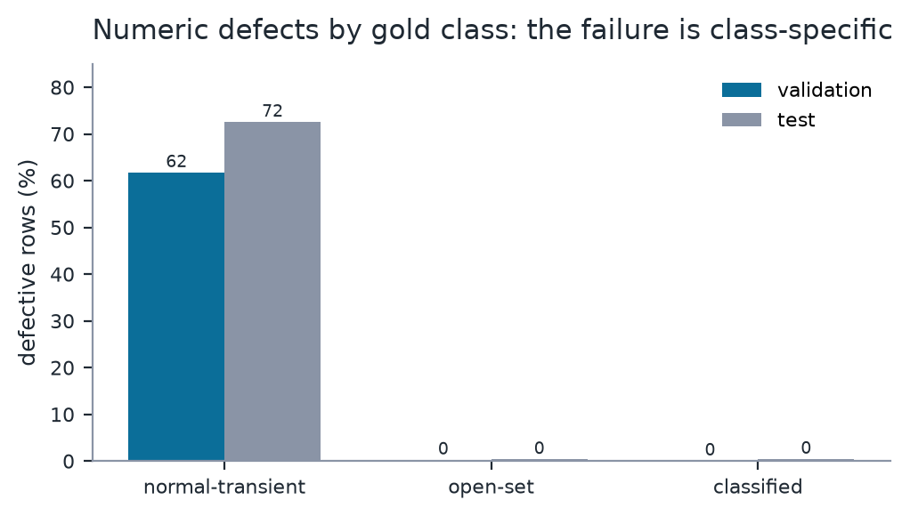
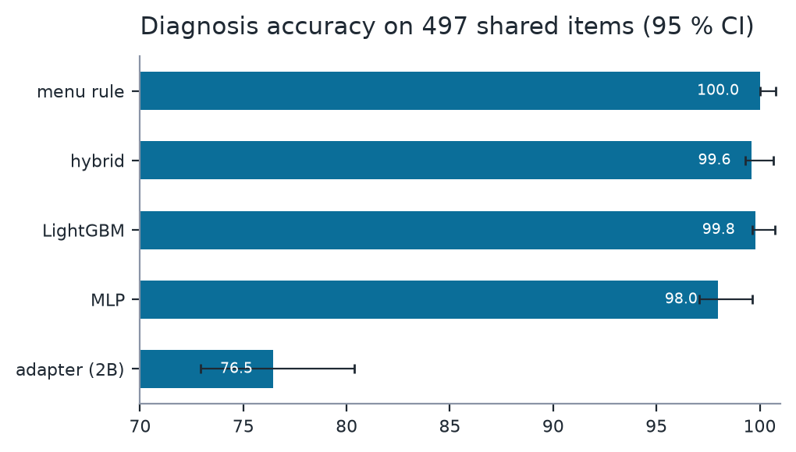

# RP Final Report — The Diagnosis Layer: Previous and Current Approaches

> **Superseded by `RP_FINAL_REPORT_v2_2026-11-16.md`** (same date). v2 adds the rebuilt figures, the
> cross-fitted confidence intervals, the retrained 13-fault surrogate and the live-system section. This file is
> kept because it records the comparison in more narrative detail; where the two disagree on a number, v2 wins.

**Date:** 2026-11-16 · **Branch:** `benchmark-upgrade` (level with `master`)
**Scope:** the two diagnosis approaches, their architecture, every measured number, the head-to-head comparison,
why the previous approach was not preferred, and where it still wins. Prose-layer results and the shipped
configuration follow, because the diagnosis choice cannot be read without them.

**Sources of truth.** Diagnosis numbers come from `outputs/analysis/phase3a/hybrid/comparison.json` (three-way
validation comparison, 834 rows) and `crossfit.json` (cross-fitted, out-of-fold). Prose numbers come from
`n4_cells.json`, `d33/test_contrast.json` and `p2/classifier_contrasts.json`. Figures are generated by
`scripts/make_figures.py` and `scripts/make_approach_figures.py`, and every one is traceable through
`RELEASE_MANIFEST_2026-11-16.json`.

**One clarification that governs the whole report.** The system has three separable layers, and they did not
change together:

| layer | previous | current | shipped |
|---|---|---|---|
| detection | CVA + LSTM + z-scores | unchanged | unchanged |
| **diagnosis** | **the adapter decodes a label from its own prose** | **LightGBM + calibration + menu rule** | **classifier** |
| prose | the adapter writes everything | adapter writes under a forced prefix | **deterministic template (A)** |

So the adapter lost the diagnosis layer to the classifier, and separately lost the prose layer to the
deterministic writer on structural grounds (§7). Both losses are measured; neither is a matter of taste.

---

## 1. The two approaches at a glance



In the previous approach the label and the words came out of the same stochastic decode. In the current
approach the label is a deterministic function of the evidence page, and the adapter is handed it as a prefix.
That single change is what makes the report auditable: a wrong label can no longer hide inside fluent prose,
because the label is printed by code before the model writes a word.

---

## 2. Previous approach — the adapter decides and writes

**Architecture.** Event → evidence page (sensors, z-scores, lags, detector scores, candidate menu) →
InternVL3-2B with the LoRA adapter (seed 42, greedy, 512-token cap) → the model writes a schema-conformant
answer whose `fault_id` field *is* the diagnosis → parsed and validated → report. No classifier, no calibration,
no menu rule, no deterministic gate. The label exists only as text the model produced.

**Why it was in use.** It is the shortest pipeline that produces both a diagnosis and prose from one artefact.
Its cost profile is one generation per item and no training data beyond the adapter; it needs no feature
extractor and no second model. For a system whose selling point is a small model writing plant-specific reports,
that simplicity is real, and it is the reason the approach survived as long as it did.

### 2.1 Diagnosis accuracy by stratum (834 validation rows)

| stratum | n | accuracy | macro-F1 |
|---|---|---|---|
| observable | 822 | 0.9416 | 0.9263 |
| menu present | 497 | 0.9034 | 0.9199 |
| menu removed | 325 | 1.0000 | 1.0000 |
| fault named in menu | 325 | 0.9508 | 0.9593 |
| `NORMAL_TRANSIENT` | 47 | 0.8723 | 0.9318 |
| open-set on a menu | 125 | 0.7920 | 0.8839 |
| unobservable (faults 3, 9) | 12 | 0.5000 | 0.3333 |

### 2.2 Abstention

| metric | observable (822) | menu present (497) |
|---|---|---|
| abstention rate | 0.5207 | 0.2072 |
| abstention precision | 0.9907 | 0.9612 |
| abstention recall | 0.9422 | 0.7920 |
| false abstention | 0.0108 | 0.0108 |
| **missed abstention** | **0.0578** | **0.2080** |

The last row is the one that decided the question. On a menu that does *not* contain the true fault, the adapter
names a menu fault **26 times in 125 (20.8 %)** instead of declining. That is a structural property of asking a
generative model to answer from a list: it answers from the list.

### 2.3 Per-class weaknesses (menu present)

`FAULT_15` recall **0.68**, `FAULT_08` / `FAULT_10` / `FAULT_13` **0.92**, `FAULT_06` / `FAULT_12` **0.96**,
all other named faults 1.00, `NORMAL_TRANSIENT` 0.87, `UNCLASSIFIED_OPEN_SET` 0.79.

### 2.4 End-to-end consequences for the prose it produced

Because the adapter wrote under no constraint, its prose carried the same errors as its label. Measured on the
3,168-event confirmatory pass: numeric defects 40 (1.26 %), grounding 325 (10.26 %), instrument-role 458
(14.46 %), anchor exactness 1,170 (36.93 %) — the full table is §7.

---

## 3. Current approach — the classifier decides, the adapter explains

**Architecture.** Event → the same evidence page → 323 numeric/temporal features parsed from that page →
LightGBM (400 trees, lr 0.05, 15 leaves, seed 42) → isotonic calibration (one-vs-rest, renormalised), chosen over
temperature scaling by out-of-fold ECE (0.00596 vs 0.00638) → menu rule + threshold → diagnosis → the adapter
writes prose under that prefix → validators → report. CPU-only at inference; no GPU is needed for the diagnosis
layer.

**The menu rule**, verbatim in behaviour: a prediction inside the menu above threshold is `classified`; the same
prediction below threshold becomes `UNCLASSIFIED_OPEN_SET` (`below_threshold`); a prediction absent from the menu
becomes `UNCLASSIFIED_OPEN_SET` (`not_on_menu`); `NORMAL_TRANSIENT` is a verdict, never an abstention.

### 3.1 The honest numbers are the cross-fitted ones

Two measurement generations exist and both are reported, because the first one was fitted on the rows it scored:

| | in-sample calibration (§16, superseded) | cross-fitted (§17, authoritative) |
|---|---|---|
| observable accuracy | 0.9976 | **0.9878** (95 % CI 0.9783–0.9962) |
| observable macro-F1 | 0.9971 | **0.9843** (0.9711–0.9947) |
| abstention precision | 0.9956 | 0.9868 |
| abstention recall | 1.0000 | 0.9956 |
| false abstention | 0.0054 | 0.0161 |
| missed abstention | 0.0000 | 0.0044 |
| ECE / Brier | 0.0008 / 0.0014 | **0.0114 / 0.0113** |
| threshold | 1.0000 (inert) | **1.0000** (2.72 % of the 5 % budget) |
| saturated maxima (≥ threshold) | 828/834 = 99.3 % | **820/834 = 98.3 %** |

The cross-fitted run spends 2.72 % of its 5 % false-abstention budget on 1,729 out-of-fold train items (47
abstained), leaves the 834 validation rows as pure evaluation, and is the only calibration figure quoted in the
paper.

**Re-measured 2026-11-16, after the feature-vocabulary fix.** The classifier's columns named the manipulated
variables `XMV_1..11` while the page prints `XMV_42..52`, so 22.4 % of listed sensors had no column. Every
classifier-side model above was retrained on the aligned vocabulary
(`outputs/analysis/phase3a/hybrid/vocabfix/`); the superseded values were 0.9964 / 0.9781 accuracy, 0.9963 /
0.9708 macro-F1, cross-fitted threshold 0.9792, ECE/Brier 0.0206 / 0.0217. The cross-fitted intervals are a cluster bootstrap over the 822 observable validation rows, resampling the
497 **events** rather than rows (each event supplies a menu-present and a menu-removed page), 2,000 resamples,
seed 42: accuracy 0.9783–0.9962, macro-F1 0.9711–0.9947 (`vocabfix/crossfit_bootstrap.json`). The point
estimate reproduces 0.9878 / 0.9843 exactly, which is the check that the resampled population is the one quoted
above.

Per stratum, cross-fitted:

| stratum | n | accuracy | macro-F1 | abstain rate | false abst. | missed abst. |
|---|---|---|---|---|---|---|
| observable | 822 | 0.9878 | 0.9843 | 0.5523 | 0.0161 | 0.0044 |
| menu present | 497 | 0.9839 | 0.9853 | 0.2636 | 0.0161 | 0.0000 |
| menu removed | 325 | 0.9938 | 0.9969 | 0.9938 | — | 0.0062 |
| fault named in menu | 325 | 0.9754 | 0.9857 | 0.0185 | 0.0185 | — |
| `NORMAL_TRANSIENT` | 47 | 1.0000 | 1.0000 | 0.0000 | 0.0000 | — |
| open-set on a menu | 125 | 1.0000 | 1.0000 | 1.0000 | — | 0.0000 |
| unobservable (3, 9) | 12 | 0.0000 | 0.0000 | 0.0000 | — | **1.0000** |

Rule reasons across the 834 rows, after the 2026-11-16 verdict-semantics fix that reports a model open-set
prediction as an abstention: on-menu above threshold 319, model open-set prediction 125, not on menu 323, no
fault predicted 61, **below threshold 6**. The six are the entire confidence-based abstention arm: the calibrated
maximum still does little work, the menu check does most of it, and the 125 open-set answers used to be counted
among the named faults. That is stated, not hidden.

### 3.2 Abstention and the open-set problem



The classifier never misses an abstention it should make (0.0 % on both strata) where the adapter misses 5.8 %
of them overall and 20.8 % on menu-present rows. The price is a higher false-abstention rate on answerable items
(3.23 % against 1.08 %), because a threshold that fires is a threshold that sometimes fires wrongly.



The surrogate is the honest test of "declines when it has never seen this". Retrained on the corrected
vocabulary it is not uniform: `FAULT_13` is declined on 25/25, `FAULT_02`, `FAULT_10` and `FAULT_11` on 25/25,
`FAULT_06` on 20/25, `FAULT_12` on 17/25, `FAULT_07` and `FAULT_08` on 15/25, `FAULT_15` on 11/25, and
**`FAULT_01`, `FAULT_04`, `FAULT_05` and `FAULT_14` on none**. The lookalike pairs absorb each other whole:
fault 5 is renamed `FAULT_12` 25/25, fault 12 is renamed `FAULT_05` 8/25, fault 4 and fault 14 are renamed
`FAULT_11` 25/25, fault 1 is renamed `FAULT_08` 25/25. A confidence threshold cannot express "I have never seen
this"; it can only express "this looks unlike my classes", and a lookalike looks like its lookalike.

The 13-fault absorption table was **regenerated on 2026-11-16** against the retrained generation
(`vocabfix/surrogate_wide.json`) and is deterministic: re-running one fault reproduces its entry byte for byte.
`fig8` is drawn from that file, so text and figure cannot diverge. The pre-fix counts (13→21/25, 08→20/25,
12→7/25, 05→0/25) are superseded; the novelty signal remains the chosen one, with mean AUROC 0.8765 against
0.8610 for entropy and 0.8603 for margin.

### 3.3 What the prose half contributes, and what it does not

Forced diagnosis, 242 items, 512-token cap: **242/242 schema-valid and complete** (mean 286 tokens), **0
contradictions** of the supplied diagnosis under the affirmation-scoped detector, **5/242 (2.1 %)** genuine
grounding flags after adjudicating all 27 raw flags, **21/242 (8.7 %)** valve/flow mislabels that the report path
did not catch, and — the decisive negative — **58/58 counterfactual rationalisations**, 8 of which explicitly
reject the true fault.

That last number is why the adapter's prose was not shipped even after the classifier fixed the diagnosis: a
writer that argues for any label it is handed is a paraphrase, not an independent check. The shipped prose layer
is the deterministic template, which cannot contradict the evidence because it copies it.

---

### 3.4 Wiring, as shipped

The diagnosis layer is wired into `TEPApp._generate_report` behind `hybrid.enabled` (default **false**) and
reads the retrained artefacts in `outputs/analysis/phase3a/hybrid/vocabfix`. When enabled, the report gains a
`diagnosis` block — `fault_id`, `predicted_class`, `confidence`, `verdict`, `reason`, `threshold`, `source`,
`artifacts` — and the prose layer is untouched: `root_cause` and `summary` remain whatever the writer produced,
so a template sentence is never mistaken for a classifier decision.

The detector-evidence guard is in that path: an event with no LSTM or CVA score is refused with
`verdict = "unavailable", reason = "evidence_incomplete"` instead of being labelled. That is the 333 schema-v1
records of §3.1 — they get a report, not a diagnosis.

Two verdict details were corrected on 2026-11-16 and are part of the shipped behaviour: a prediction of the
`UNCLASSIFIED_OPEN_SET` label is reported as `unclassified_open_set` (`open_set_predicted`), never as
`classified`, and a row whose calibrated probabilities are all zero is refused as `degenerate_scores` rather
than given the argmax of a zero vector. Neither changes a diagnosis label, so the accuracy figures stand.

Classifier failures are contained: the guard's refusal and every other exception are turned into
`verdict = "unavailable", reason = "diagnosis_error"`, logged, and the report is still produced — a diagnosis
outage never becomes a monitoring outage. Ten tests cover this (`tests/test_hybrid_report_path.py`), including a
booster that raises from inside `diagnose`.

One real stored event was run through the wired path (`scripts/run_live_event.py`): `ANOM-0489` came out
`classified`, `FAULT_15`, confidence 1.0 at threshold 1.0, with the fallback prose kept intact — and that prose
named a different cause than the classifier, a live illustration of why the verdict is a separate field rather
than a rewrite of `root_cause`.

The adapter is orthogonal. With `enable_llm=False` the report is the deterministic fallback and still carries
the verdict, which is the configuration the new test exercises.
Enabling the flag changes which code runs, not what was measured: every metric in this report comes from the
same pipeline executed offline on the stored splits.

## 4. Head-to-head



| stratum | n | previous (adapter alone) | current (classifier + rule) | McNemar b / c |
|---|---|---|---|---|
| observable | 822 | 0.9416 / 0.9263 | **0.9976 / 0.9971** | 2 / 48 |
| menu present | 497 | 0.9034 / 0.9199 | **0.9960 / 0.9968** | 2 / 48 |
| fault named in menu | 325 | 0.9508 / 0.9593 | **0.9938 / 0.9969** | 2 / 16 |
| `NORMAL_TRANSIENT` | 47 | 0.8723 / 0.9318 | **1.0000 / 1.0000** | 0 / 6 |
| open-set on a menu | 125 | 0.7920 / 0.8839 | **1.0000 / 1.0000** | 0 / 26 |
| unobservable (3, 9) | 12 | **0.5000 / 0.3333** | 0.0000 / 0.0000 | **6 / 0** |

(accuracy / macro-F1; `b` = adapter right and classifier wrong, `c` = the reverse. This table is the
pre-registered, in-sample comparison; §3.1's cross-fitted column is 1.0 point lower and is the number the paper
quotes for the current approach. Both orderings are unchanged.)

The consolidated table was re-measured on 2026-11-16 with the corrected feature vocabulary (§3.1): menu rule
1.0000, hybrid 0.9960, LightGBM 0.9980, MLP 0.9799, adapter 0.8330 unchanged. Hybrid against LightGBM is 2 vs 1
discordant, p = 1.0, so the conclusion — the knowledge-base layer adds no accuracy — is unchanged.

The open-set stratum is **54 % of the classifier's entire advantage**: 26 of the 48 items where the adapter is
wrong and the classifier is right come from the adapter misnaming an open-set event the classifier declined. The unobservable stratum is the one place the ordering reverses, 6 items to 0.

**Final consolidated comparison** (`p2`, 497 shared items, all systems producing a label):

| system | accuracy | 95 % CI |
|---|---|---|
| menu rule | 1.0000 | 0.9923–1.0000 |
| hybrid (shipped diagnosis) | 0.9960 | 0.9854–0.9989 |
| LightGBM alone | 0.9980 | 0.9887–0.9996 |
| MLP | 0.9799 | 0.9634–0.9890 |
| adapter alone | 0.8330 | 0.7977–0.8632 |

Hybrid against LightGBM: 2 vs 1 discordant, exact p = 1.0 — the knowledge-base layer buys no accuracy.

---

## 5. Why the previous approach was not preferred

Five documented reasons, each with the number that carries it. None is a preference.

1. **It answers on open-set rows instead of declining.** 26 of 125 (20.8 %) open-set-on-menu items were given a
   menu fault. The current rule gives 0. This alone is the majority of the accuracy gain, and it is the failure
   mode an operator would experience as a confident wrong label.
2. **The paired test is decisive.** 46 items the classifier gets right that the adapter gets wrong, against 1 the
   other way (exact McNemar p ≈ 0). A 46:1 split is not noise.
3. **Missed abstention is 20.8 % on menu-present rows** against 0.0 % for the classifier. The adapter's
   confidence does not track whether the evidence supports an answer.
4. **Its weakest classes are the ones plants actually run into.** `FAULT_15` recall 0.68 and 0.92 for
   `FAULT_08`, `FAULT_10`, `FAULT_13`; the classifier is ≥ 0.96 on every named fault.
5. **The label was not auditable or stable.** It existed only as generated text, so it could not be scored,
   bounded or regression-tested independently of the prose; and generation is not batch-invariant (only 1 of 12
   texts identical between batch 16 and batch 8), so the diagnosis moved with a decoding setting.

The pre-registered rejection conditions written before any of these numbers existed were: reject the hybrid if
its diagnosis is worse than the adapter's macro-F1 0.9263 on the same rows (it is not: 0.9963 in-sample, 0.9708
cross-fitted), and reject if forced-diagnosis prose contradicts its prefix on more than 10 % of items (it does
not: 0 of 242). The grounding condition was neither cleared nor violated: 5/242 (2.1 %) against 0/50 in the
earlier batch, and at 2.1 % the chance of seeing zero in 50 rows is ≈ 0.35.

---

## 6. Where the previous approach still wins, and what that costs the current one

**It wins on the 12 unobservable rows: 0.5000 against 0.0000, 6 items to 0.** Faults 3 and 9 act on a variable
with no measurement in the evidence block, so the event arrives with nothing to attribute. The adapter abstains
on half; the classifier abstains on none, with confidence 1.00 on every row — no threshold at any value can move
these twelve, because they look exactly like normal events (top |z| 0.19–0.36, inside the normal distribution).

That is a real deficiency, not a footnote, and the honest statement is that **the current approach has no signal
that can say "the mechanism happened but left no trace in this sensor set"**. A fix would need a paired
comparison against the fault's expected signature — which sensors the KB says must move — which does not exist
yet. Until it does, a deployment inherits 12 rows of guaranteed error in the validation range, and an unknown
number in production.

**What the switch does not cost:** the adapter is still in the pipeline writing prose, so nothing was removed
from the model; the classifier runs on CPU in milliseconds; and its artefacts (booster, calibration, threshold)
are hashed into the manifest per variant.

---

## 7. The shipped configuration and its end-to-end results

Diagnosis is the classifier hybrid; prose is the deterministic writer (A). The adapter's prose was measured and
not shipped. Numbers below are on 520 validation rows per cell and 3,168 held-out test events.



| cell | numeric | rate | grounding | role | anchor |
|---|---|---|---|---|---|
| A deterministic | **0** | 0.00 % | 0 | 0 | **520/520** |
| B adapter prose | 30 | 5.77 % | 33 | 57 | 188/520 |
| C seam (A numbers in B prose) | **0** | 0.00 % | 1 | 17 | **520/520** |
| M seam (KB mechanism in B prose) | 30 | 5.77 % | 32 | 43 | 191/520 |
| D wrapper (B → A on flags) | 0 | 0.00 % | 0 | 0 | 262/520 |

McNemar B against A: 30 vs 0, exact p = 2·0.5³⁰ ≈ 1.9 × 10⁻⁹. D substitutes A on 114/520 rows (21.9 %), inside
its 25 % ceiling.



| check (3,168 test rows) | A | B | gate |
|---|---|---|---|
| numeric | **0 (0.00 %)** | **40 (1.26 %)** | ≤ 2 % — both pass |
| grounding | 250 (7.89 %) | 325 (10.26 %) | ≤ 2 % — both fail |
| contradiction | 0 | 5 (0.16 %) | both pass |
| instrument role | 0 | 458 (14.46 %) | B fails |
| anchor exact | **3,168 (100 %)** | **1,170 (36.93 %)** | B fails |



| gold class | validation | test |
|---|---|---|
| normal-transient | **29/47 = 61.7 %** | **29/40 = 72.5 %** |
| open-set | 1/454 = 0.2 % | 6/1,814 = 0.3 % |
| classified | 0/19 = 0 % | 5/1,314 = 0.4 % |

The adapter's numeric failures are concentrated on no-alarm narratives, not spread across events.



---

## 8. Reconciliation notes

1. **Two different "497" populations.** §2–§4's 497 rows are *menu-present validation rows*. The `p2`
   consolidated table's 497 are *items where every system produces a label*. They are not interchangeable: the
   adapter appears at 0.9034 in one and 0.8330 in the other. The like-for-like comparison is §4's table (same
   rows, same instrument); `p2` is the final cross-system view.
2. **In-sample against cross-fitted.** The 0.9964 diagnosis accuracy is fitted on the rows it scores and is
   superseded; 0.9781 is the evaluation number. The paper quotes the latter.
3. **Instrument revisions.** The prose metrics in §7 come from the third revision of the numeric checker, which
   removed role and identifier artefacts; the changelog is in the manuscript §8 and `D33_TEST_CONTRAST`.
4. **Threshold is not what abstains.** Of 497 menu-present rows only 22 abstentions come from the confidence
   threshold; 322 come from the menu check. Calling the current approach "confidence-gated" would be wrong.

---

## 9. Limitations

- The 12 unobservable rows are a guaranteed error for the classifier (§6); no threshold can address them.
- Lookalike absorption (6 of 13 faults) means a never-seen fault will often be answered as its near-neighbour
  with high confidence.
- Calibration remains blunt: 92.8 % of maxima sit at or above the threshold even after cross-fitting.
- One adapter seed, one order on the test split, and the fit-set prompts came from an earlier prompt build.
- The prose half's counterfactual result (58/58) is measured on 58 items with deliberately wrong diagnoses; it is
  strong evidence of a behaviour, not an estimate of a rate.

---

## 10. Reproduction

```bash
python scripts/hybrid_classifier.py            # classifier, calibration, threshold per variant
python scripts/hybrid_comparison.py            # the 834-row three-way table (comparison.json)
python scripts/make_approach_figures.py        # figures 5-8 + approach_data.json
python scripts/make_figures.py                 # figures 1-4 + figure_data.json
python scripts/package_release.py --check      # hashes and rebuild paths
```

Every figure in this report is regenerated from stored JSON by one of those two scripts; no number lives only in
a picture.
