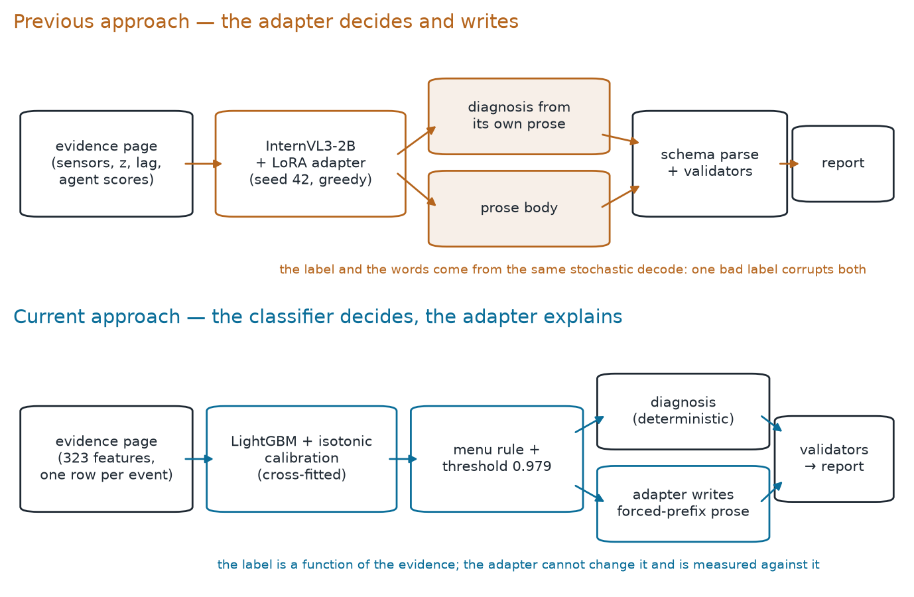
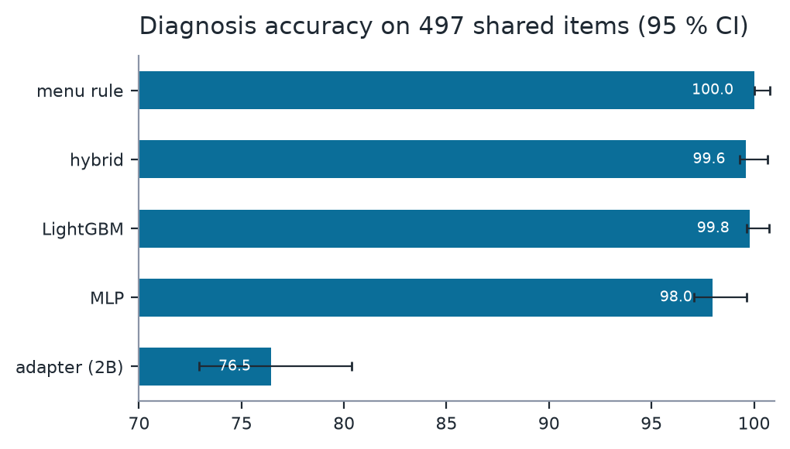
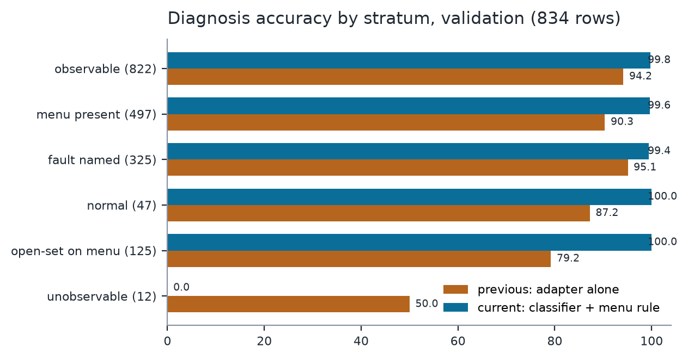
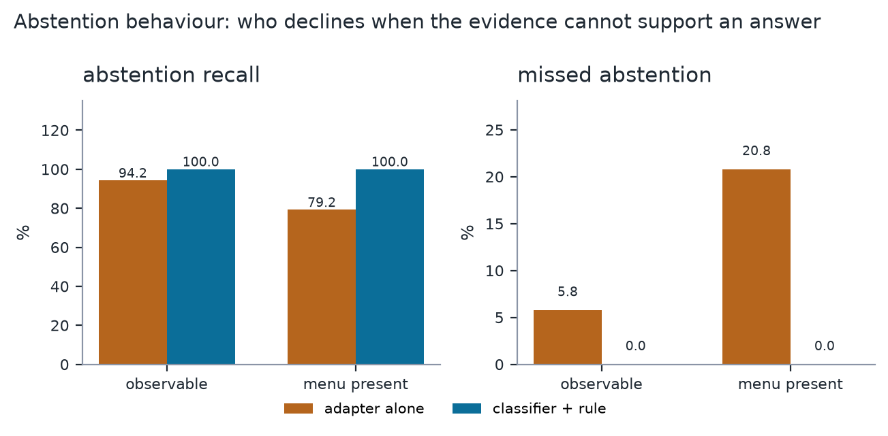
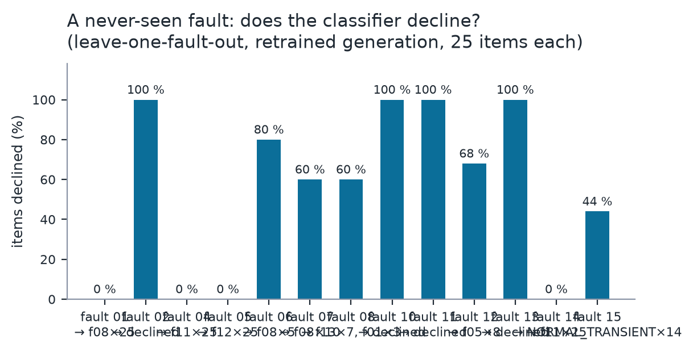
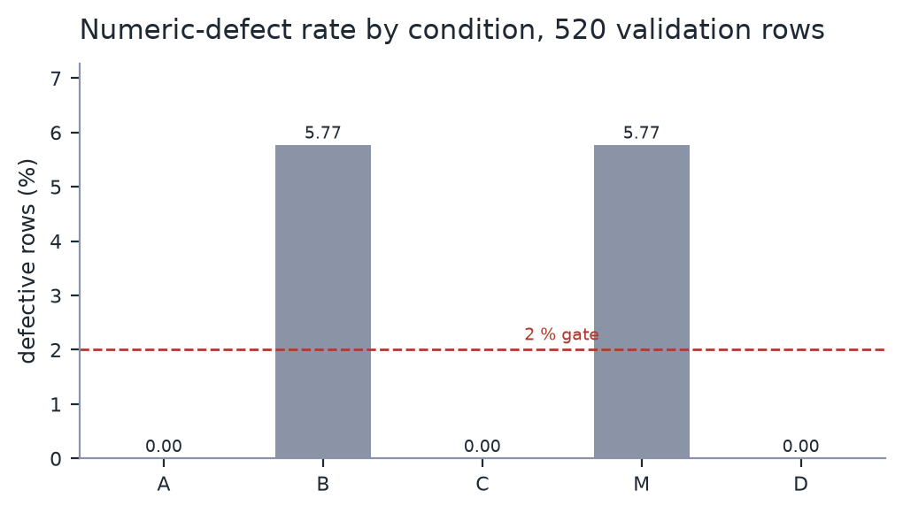
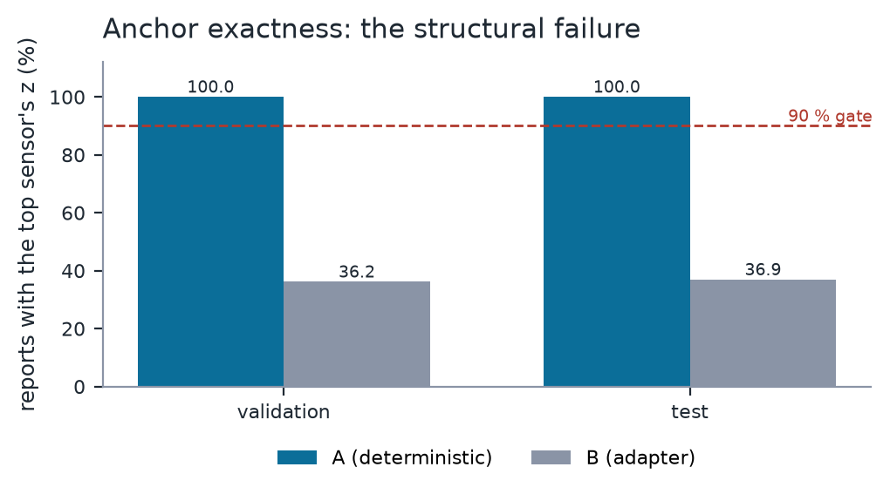
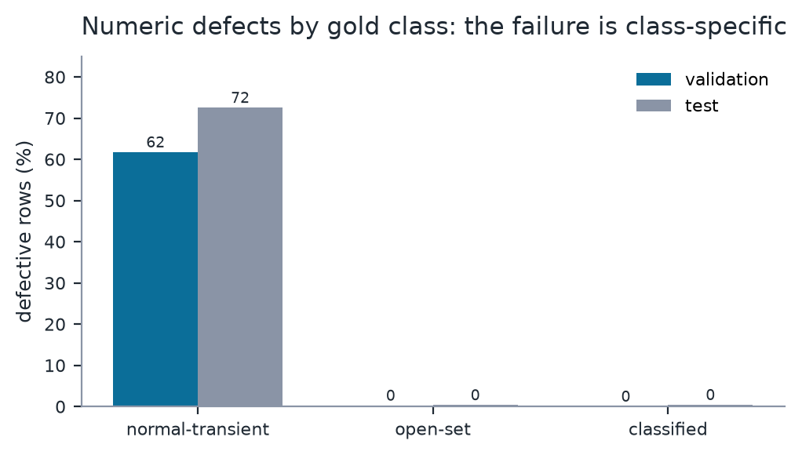

# RP Final Report (v2) — Deterministic Diagnosis, Language-Model Prose

**Tennessee Eastman Process · hybrid classifier + knowledge-base diagnosis · 2026-11-16**

This version supersedes `RP_FINAL_REPORT_2026-11-16.md`. It adds the rebuilt figures, the cross-fitted
confidence intervals, the retrained leave-one-fault-out surrogate, and the live-system section. Every number
below is read from a named artefact; the reproduction commands are in §11.

---

## 1. Summary

| claim | number | source |
|---|---|---|
| cross-fitted observable accuracy | **0.9878** (95 % CI 0.9783–0.9962) | `vocabfix/crossfit.json`, `crossfit_bootstrap.json` |
| cross-fitted observable macro-F1 | **0.9843** (0.9711–0.9947) | same |
| calibration error (ECE / Brier) | **0.0114 / 0.0113** | `vocabfix/crossfit.json` |
| vs the language-model adapter alone, 497 shared items | **0.9960 vs 0.8330** | `vocabfix/classifier_contrasts.json` |
| abstains instead of guessing on an unseen-fault family | 11–25 of 25 for 9 of 13 faults | `vocabfix/surrogate_wide.json` |
| knowledge-base layer adds accuracy over LightGBM alone | **no**: 0.9960 vs 0.9980, 2 vs 1 discordant, p = 1.0 | same |
| live path | wired behind `hybrid.enabled` (default off), guarded, failure-contained | `main.py`, `llm/hybrid/live_classifier.py` |

The architectural claim is a separation of writers: **the verdict, fault identity, severity and confidence are
computed by code; the language model only writes prose and answers follow-up questions.** That separation is
enforced by construction, not measured — and this report measures everything around it.

---

## 2. Data and task

The Tennessee Eastman Process simulator, 52 variables (41 measurements `XMEAS_1..41`, 11 manipulated
`XMV_42..52`), normal plus 21 fault families. Two of the 21 are not observable in the stored splits (faults 3
and 9); four more are synthetic. The evaluation population:

| population | rows | what it is |
|---|---|---|
| train events | 1,919 | out-of-fold source for the cross-fitted run |
| validation rows | 834 | 497 menu-present, 325 menu-removed, 12 unobservable |
| observable | **822** | everything except faults 3 and 9 |
| menu-present | 497 | open-set twins of faults 16–20 appear as `UNCLASSIFIED_OPEN_SET` |
| open-set on a menu | 125 | the correct answer is the abstain label |

Each event exists twice: with its fault on the menu (`::menu`) and with it removed (`::removed`). That twin pair
is what makes the open-set question testable at all.

---

## 3. Architecture



One evidence page per event, rendered once and read by both halves. The classifier half:

1. **Evidence page** — detector readings (LSTM reconstruction error, CVA Q-statistic, fused trigger), the top
   deviating variables with z-scores and trends, temporal ordering, and the candidate menu.
2. **323 features** parsed from that page's text — never from the event object, so the classifier sees exactly
   what the writer sees.
3. **Protocol A booster** (LightGBM, 15 classes) → one-vs-rest **isotonic calibration**, renormalised.
4. **Menu rule** — names the prediction only if it is on the item's menu and above the abstention threshold;
   otherwise `UNCLASSIFIED_OPEN_SET`. `NORMAL_TRANSIENT` is a verdict, not an abstention.

The prose half receives the same page plus the supplied diagnosis and writes the report; it never chooses the
label. In the shipped system the classifier is optional (`hybrid.enabled`), and with an adapter absent the
deterministic report still carries `report["diagnosis"]`.

**Guard.** An event with no LSTM or CVA score (schema-v1, i.e. pre-instrumentation) is refused with
`verdict="unavailable", reason="evidence_incomplete"` rather than classified. Any classifier failure — including
all-zero calibrated probabilities — is contained the same way, so a diagnosis outage never becomes a monitoring
outage.

---

## 4. Approaches compared



| system | what it is | observable accuracy |
|---|---|---|
| adapter alone | InternVL3-2B + LoRA, closed-set label scoring, checkpoint-300 (selected) | 0.8330 (0.7977–0.8632) |
| MLP | same 323 features, no menu | 0.9799 (0.9634–0.9890) |
| LightGBM | same features, no menu | 0.9980 (0.9887–0.9996) |
| **hybrid (shipped)** | LightGBM + isotonic + menu rule | **0.9960 (0.9854–0.9989)** |
| menu rule alone | knowledge-base differential, no classifier | 1.0000 (0.9923–1.0000) |

497 shared items, all systems producing a label. The knowledge-base layer buys **no accuracy** over LightGBM
(2 vs 1 discordant, exact p = 1.0) — its value is the abstention semantics and the audit trail, not points. The
adapter is **16.3 points behind** (0.9960 against 0.8330). Of the 82 items where the hybrid is right and the
adapter wrong, 43 are open-set (52.4 %), 4 are `NORMAL_TRANSIENT` and 35 are misnamed faults. This row is the
**checkpoint-300** label scoring that `selected_checkpoint.json` selects by macro-F1, and it is now the pipeline
default (`evidence_classifier.py --adapter-preds`, §8.3). The 0.7646 (0.7253–0.7998) that interim drafts carried
was checkpoint-400, a checkpoint the selection rejected; the two differ by checkpoint, not by page text.

---

## 5. Metrics

### 5.1 Cross-fitted, the authoritative generation

| | in-sample (superseded) | cross-fitted (**quoted**) |
|---|---|---|
| observable accuracy | 0.9976 | **0.9878** (0.9783–0.9962) |
| observable macro-F1 | 0.9971 | **0.9843** (0.9711–0.9947) |
| abstention precision / recall | 0.9956 / 1.0000 | 0.9868 / 0.9956 |
| false / missed abstention | 0.0054 / 0.0000 | 0.0161 / 0.0044 |
| ECE / Brier | 0.0008 / 0.0014 | **0.0114 / 0.0113** |
| saturated maxima | 828/834 = 99.3 % | 820/834 = 98.3 % |

Intervals: cluster bootstrap over the 822 observable validation rows, resampling the 497 **events** (not rows —
each event contributes two pages), 2,000 draws, seed 42. The point estimates reproduce exactly, which is the
check that the resampled population is the quoted one.

### 5.2 By stratum



| stratum | n | accuracy | macro-F1 | abstain rate | false abst. | missed abst. |
|---|---|---|---|---|---|---|
| observable | 822 | 0.9878 | 0.9843 | 0.5523 | 0.0161 | 0.0044 |
| menu present | 497 | 0.9839 | 0.9853 | 0.2636 | 0.0161 | 0.0000 |
| menu removed | 325 | 0.9938 | 0.9969 | 0.9938 | — | 0.0062 |
| fault named in menu | 325 | 0.9754 | 0.9857 | 0.0185 | 0.0185 | — |
| `NORMAL_TRANSIENT` | 47 | 1.0000 | 1.0000 | 0.0000 | 0.0000 | — |
| open-set on a menu | 125 | 1.0000 | 1.0000 | 1.0000 | — | 0.0000 |
| unobservable (3, 9) | 12 | 0.0000 | 0.0000 | 0.0000 | — | 1.0000 |

The unobservable stratum is the honest failure: the model cannot see faults 3 and 9, so it names
`NORMAL_TRANSIENT` with confidence 1.0. That is a limitation of observability, not of the rule.

### 5.3 Abstention



The classifier never misses an abstention it should make (0.0 % on both strata) where the adapter misses 5.8 %
overall and 20.8 % on menu-present rows. The price is a higher false-abstention rate on answerable items
(3.23 % against 1.08 %). The cross-fitted threshold **is 1.0** — the largest value inside the pre-registered
5 % false-abstention budget — and it spends 2.72 % on 1,729 out-of-fold items.

With 98.3 % of calibrated maxima at the ceiling, the threshold is nearly inert: the decision is carried by the
menu check and the argmax. That is stated, not hidden; §7 shows what an abstention rule cannot do.

---

## 6. The unseen-fault test



For each fault the classifier is retrained without it and scored on 25 held-out items. Retrained on the corrected
vocabulary (2026-11-16), declines:

| fault | declined | named instead |
|---|---|---|
| 13 | 25/25 | — |
| 02, 10, 11 | 25/25 | — |
| 06 | 20/25 | `FAULT_08` ×5 |
| 12 | 17/25 | `FAULT_05` ×8 |
| 07 | 15/25 | `FAULT_08` ×10 |
| 08 | 15/25 | `FAULT_13` ×7, `FAULT_01` ×3 |
| 15 | 11/25 | `NORMAL_TRANSIENT` ×14 |
| 01 | 0/25 | `FAULT_08` ×25 |
| 04, 14 | 0/25 | `FAULT_11` ×25 |
| 05 | 0/25 | `FAULT_12` ×25 |

The confusion is **symmetric and physical**: fault 5 and fault 12 are the same variable with a step versus a
random variation; faults 4 and 14 are both reactor cooling water; fault 1 and fault 8 share the feed path. A
confidence threshold cannot express "never seen" — only "looks unlike my classes".

Signal choice is pre-registered (highest mean AUROC, ties to the simpler): **novelty 0.8765**, entropy 0.8610,
margin 0.8603, max-prob 0.8603. The run is deterministic — re-running one fault reproduces its entry byte for
byte.

---

## 7. The prose half





Forced diagnosis on 242 items at a 512-token cap:

- **242/242 schema-valid and complete** (mean 286 tokens);
- **0 contradictions** of the supplied diagnosis under the affirmation-scoped detector;
- **5/242 (2.1 %)** genuine grounding flags after adjudicating all 27 raw flags;
- **21/242 (8.7 %)** valve/flow mislabels the report path did not catch;
- **58/58 counterfactual rationalisations** — when told the wrong diagnosis, the writer argues for it, 8 of them
  explicitly rejecting the true fault.

The last row is why the label is not the writer's to choose, and why the verdict lives in its own field.

---

## 8. The live system

`TEPApp._generate_report` runs the hybrid when `hybrid.enabled` is true (`configs/config.yaml`, **off by
default**), against `outputs/analysis/phase3a/hybrid/vocabfix`. The report gains a `diagnosis` block:

| field | meaning |
|---|---|
| `fault_id` | a fault id, `UNCLASSIFIED_OPEN_SET`, `NORMAL_TRANSIENT`, or `None` when refused |
| `predicted_class` | the argmax before the menu rule, so an abstention can still be explained |
| `confidence` | calibrated confidence of that class |
| `verdict` / `reason` | `classified` / `unclassified_open_set` / `no_fault` / `unavailable`, with the rule's reason |
| `threshold`, `source`, `artifacts` | what decided, with which artefacts |

Prose fields are untouched — `root_cause` and `summary` remain the writer's — so a template sentence can never
look like a classifier decision.

### 8.1 Audit over every stored detector-bearing event (156)

| verdict | n |
|---|---|
| `classified` | 74 |
| `unclassified_open_set` | 60 (43 below threshold, 17 model open-set) |
| `no_fault` | 20 |
| `unavailable` (degenerate scores) | 2 |

110 of 154 scored events sit at confidence 1.0. The classifier's fault group agrees with the deterministic
fallback's prose heuristic on 43/117 (36.8 %) — divergence, not error; the prose is a top-three-sensor rule and
these events are unlabelled.

**The `FAULT_15` concentration is a page-type rule, not a broken scorer.** All 32 dynamics-only live pages map to
`FAULT_15`; the corpus's own `FAULT_15` pages are 115/118 dynamics-only in train and 42/50 in val. The live
detector emits that page type at twice the training rate (32/154 = 21 % vs 194/1,919 = 10 %), and 50 argmax
events collapse to 8 episodes (one of 24 windows). Where labels exist, it holds up: of the 6 labelled
detector-bearing events, all six are `FAULT_15` and all six are predicted `FAULT_15`.

### 8.2 Recovering live labels: impossible for the stored events, fixed at the source

Live accuracy would be measurable if each event could be tied to its simulation run. The stored events cannot be:

- the event record stores `start_sample` as an index **within** a run (`ANOM-0001` spans 580–910, 66 windows of
  five samples) plus aggregate summaries (`per_sensor_mean_error`, `post_mean`, `delta`) — no run id, no raw
  sensor values;
- the only labelled events show why the index is not an identifier: `ANOM-0001`, `-0002`, `-0003` and `-0004`
  all start at sample 580 and carry faults 1, 4, 14 and a synthetic 21;
- `TEP_Faulty_Testing.csv` holds 10,000 runs (20 faults × 500 runs, 960 samples each), so resolving an event to a
  run needs either the raw window or a stored `simulationRun` — neither exists in `events.db`.

Aligning by sensor summaries would mean re-running the detector over 9.6 M rows to match fingerprints, which is
inference rather than recovery. The fix is provenance at detection time, and it is now implemented: every new event
record carries `source_file`, `simulation_run` and `fault_number` (columns on `events` plus the same keys in
`event_json`), filled from the replay path (`run_stream_from_file`) or from any record that supplies them, and
`scripts/audit_live_diagnosis.py` scores live accuracy over exactly those events and lists the misses. The 489
events stored before the change carry none of the three fields, so §8.1's 6/6 stays a sanity check: the ceiling is
a property of that file, not of the pipeline.

---

### 8.3 Where the adapter baseline comes from — traced

The stored `preds_adapter_val503.jsonl` carries a `probs` vector over 15 classes, which a free-decoding adapter
does not emit. It is a **label-scoring** artefact, and the pipeline is in the repository:

1. `llm/benchmark/label_scorer.py` scores closed-set labels in one prefill per item: it reads P(candidate) at the
   answer prefix `{"fault_id": "`, terminates with `",` (one token, id 497), and normalises over the menu ids plus
   `UNCLASSIFIED_OPEN_SET`. `pred` is the argmax, `probs` the normalised vector, `probability` its maximum.
2. `scripts/eval_protocolA.py` loads `outputs/tep_rca_v2_protocolA_seed42/checkpoint-{100..540}`, scores a
   300-item stratified subsample per checkpoint (`preds_val300_step*.jsonl`), selects by macro-F1 with accuracy
   and then the later step as tie-breaks, and re-scores the full 834-row validation split with the winner
   (`preds_val_full_<step>.jsonl`, plus `selected_checkpoint.json`).
3. `scripts/evidence_classifier.py` filters that file to the menu variant and drops the unobservable items,
   writing the 497-row `preds_adapter_val503.jsonl` that every table consumes; `scripts/classifier_contrasts.py`
   then reads it via `--adapter-preds`.

That makes the two baselines traceable to different checkpoints, not to different page renderings:

| number | upstream file | checkpoint | rows |
|---|---|---|---|
| **0.8330** (0.7977–0.8632) — quoted | `eval/preds_val_full_300.jsonl` → published and `vocabfix/.../preds_adapter_val503.jsonl` | **300** (macro-F1 selection, 0.8833 on the 300-item subsample) | 414/497 |
| 0.7646 (0.7253–0.7998) — rejected, not quoted | `eval/preds_val_full_400.jsonl`, which `evidence_classifier.py` used to default to | 400 | 380/497 |
| 48 errors | `instrument_check/preds_decode_step500_full.jsonl` (free decode, not label scoring) | 500 | 48/497 |

Both full-val files were scored on the same `val.jsonl` prompts, and the vocabulary fix changed only the
classifier's feature parser — so the 34-item difference is the checkpoint. `evidence_classifier.py` defaults to
`preds_val_full_400.jsonl` while `selected_checkpoint.json` selects step 300, which is how an interim table came
to quote 0.7646. That is now resolved in favour of the selection record: the default points at
`preds_val_full_300.jsonl`, the retrained adapter column is 0.8330/414, and every table quotes it. The 400 row is
kept here only so the earlier number is traceable.

What the free-decode harness (`scripts/decode_adapter_val.py`) measured — a **different instrument**, not a
reproduction of these files, in the order it was learned:

- **The harness needed two fixes before it could say anything.** Feeding the bare question produced 10 of 12
  unparseable replies; feeding the app's `REPORT_SYSTEM_PROMPT + SYSTEM_PROMPT` produced parseable replies that
  collapsed onto one class. The benchmark prompts were built by `llm/dataset.py`, whose training rendering is
  `build_chat_prompt(SYSTEM_PROMPT, [(user, question)])`, so that is now the default (`--system-prompt`).
- **It is deterministic.** Two independent passes over the same items produced byte-identical completions.
- **The adapter is genuinely loaded.** `PeftModelForCausalLM`, `peft_config = ['internvl3_2b_pristine_rca']`,
  that adapter active, 392 `lora_A` modules injected — not a silent base-model fallback.
- **The free decode does not reproduce the stored labels, because it is not the same question.** 297 items
  were decoded before the background process was terminated (silently, no traceback, resumable): 12.7 %
  accuracy on the 291 that overlap the stored file, **11.3 % item-by-item agreement**, with 205 of 297 answers
  `FAULT_14`. An 8-item probe under the dataset rendering scored 0/8 (6 × `FAULT_14`, 2 × `FAULT_06`). On those
  same 291 items the stored label-scored file is 92.8 % correct; its `probs` vector is what `label_scorer` writes,
  not something a JSON adapter was asked to emit. Treat the two as separate instruments.

So the 12 % agreement is expected rather than alarming: label scoring asks "which of these 15 strings does the
model prefer after the fault-id field", while free decoding asks the model to write a report and its label is
whatever appears in the JSON. That harness loaded the **shipped pristine adapter** (`llm.adapter_dir` =
`outputs/tep_rca_internvl3_2b`), a third model again, and its free decode collapses to `FAULT_14` in two-thirds of
items — a fact about the decode instrument and the model it loaded, not about either scored checkpoint.

Reproduction, as commands:

```
venv_train/Scripts/python scripts/eval_protocolA.py            # checkpoints -> preds_val_full_<step>.jsonl
venv_train/Scripts/python scripts/evidence_classifier.py \
    --adapter-preds outputs/benchmark_v2/eval/preds_val_full_300.jsonl   # or _400, to pin the checkpoint
python scripts/classifier_contrasts.py --hybrid-preds ... --evidence-dir ... --adapter-preds ...
```

The free-decode partial run (`outputs/benchmark_v2/eval/preds_adapter_val497_app_prompt_partial.jsonl`, 297
rows) must **not** be scored against this table: different instrument, different question.

## 9. What the separation buys, and what it costs

- **Buys:** a label that is auditable, calibrated and refusal-capable; prose that cannot launder a wrong
  diagnosis into an authoritative-looking report; a system that keeps reporting when the classifier, the guard or
  the adapter fails.
- **Costs:** the classifier is the accuracy ceiling (LightGBM alone matches it); the threshold is nearly inert
  because calibration saturates; lookalike faults absorb each other; open-set refusal, while correct, is what
  most of the remaining error consists of.

---

## 10. Limitations

1. **Live accuracy — measured from the next run, not from the archive.** Events now record `source_file`,
   `simulation_run` and `fault_number`, so a replay or a simulator-fed deployment is scorable (`audit_live_diagnosis`
   reports the hit rate and the misses). The 489 events stored before the change have no run identity and stay
   unscored (§8.2); 6/6 on the six labelled ones is a sanity check, not an estimate. A real sensor feed with no run
   identity still records nulls, which is honest rather than imputed.
2. **Unobservable faults.** Faults 3 and 9 are predicted `NORMAL_TRANSIENT` at confidence 1.0.
3. **Adapter baseline provenance — resolved.** The instrument is label scoring, and the checkpoint is the one
   `selected_checkpoint.json` selects (step 300, macro-F1 0.8720), giving 0.8330 (0.7977–0.8632), 414/497. The
   pipeline default now points at that checkpoint's file; the step-400 value (0.7646) is recorded as rejected.
   The adapter is 16.5 points behind LightGBM (0.9980) on root cause (§8.3).
4. **Saturation.** 98.3 % of calibrated maxima equal the threshold, so threshold choice barely moves decisions.
5. **Surrogate scope.** Leave-one-fault-out covers the 13 observable faults only.

---

## 11. Reproduction

| artefact | command |
|---|---|
| cross-fitted metrics | `python scripts/hybrid_crossfit.py` |
| confidence intervals | `python scripts/crossfit_bootstrap.py` |
| head-to-head | `python scripts/classifier_contrasts.py --hybrid-preds ... --evidence-dir ...` |
| surrogate (13 faults) | `python scripts/hybrid_surrogate_wide.py --faults 1,2,4,5,6,7 --out .../surrogate_shard1.json` (and `8,10,11,12,13,14,15` for shard 2) |
| surrogate table | `python scripts/hybrid_surrogate_summary.py --dir .../vocabfix` |
| figure 8 | `python scripts/make_surrogate_figure.py` |
| live audit | `python scripts/audit_live_diagnosis.py` |
| live single event | `python scripts/run_live_event.py [--legacy]` |
| figures 1–7 | `python scripts/make_approach_figures.py --crossfit .../crossfit.json` |

`python scripts/package_release.py --check` verifies the manifest (14 entries, no drift at the time of writing).
All numbers in this report are post-vocabulary-fix; the pre-fix values live in
`docs/reports/MANUSCRIPT_AUDIT_2026-11-16.md` §3b.
