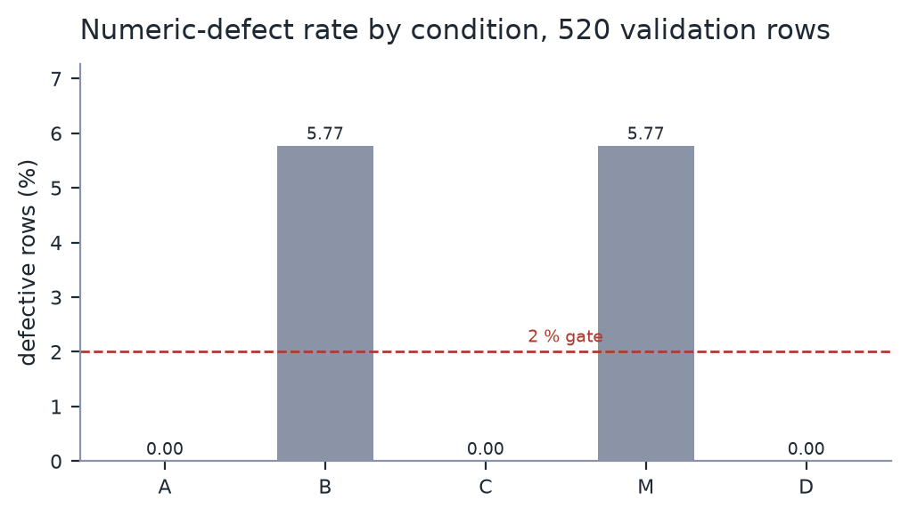
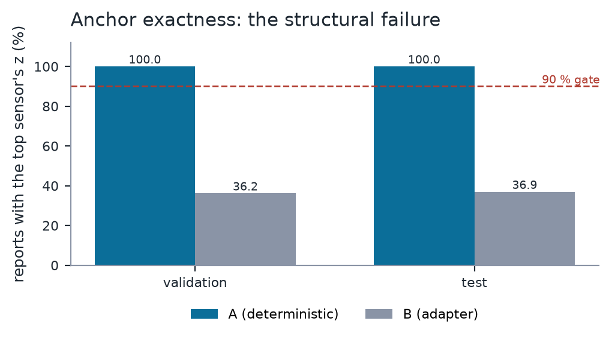
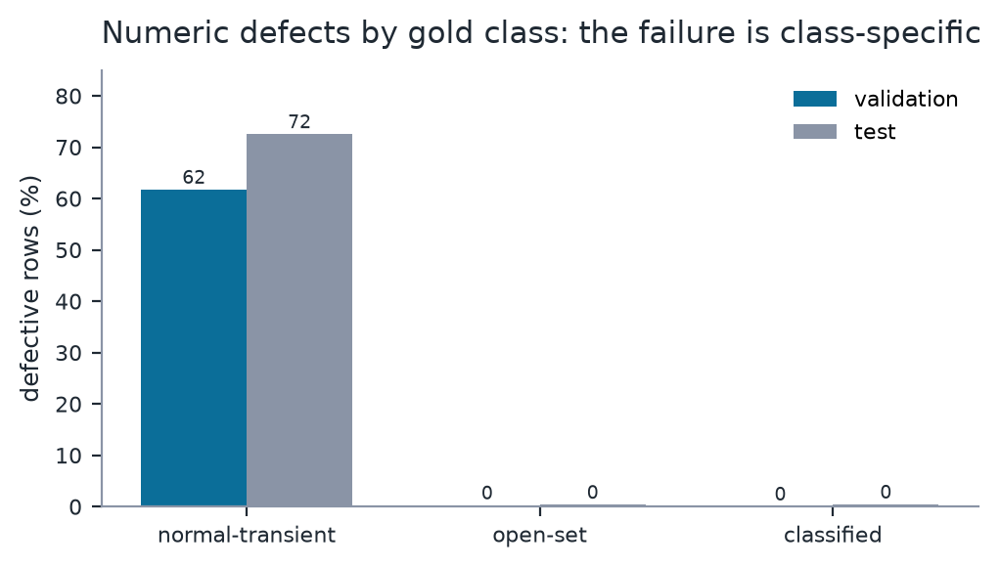
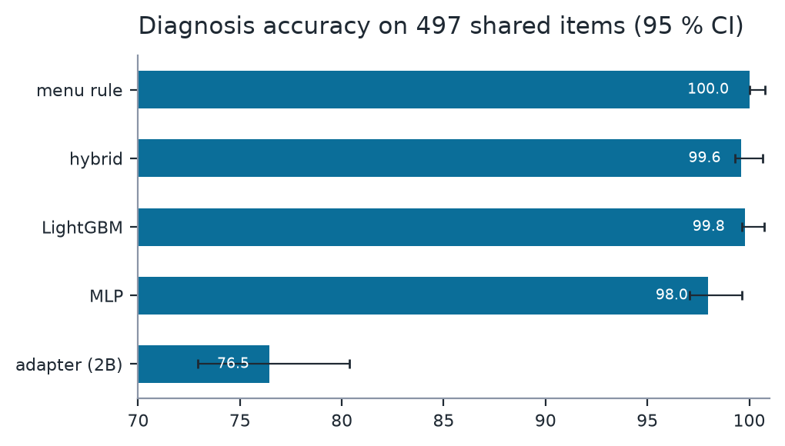

# Deterministic Diagnosis, Generative Prose: Separating Verdict from Narrative in Industrial Fault Reporting

**Journal manuscript (TEP-FP), 17 November 2026.** Single-column submission format. The paper reports the
**Version B** framing signed on 2026-11-17: the preference study is reported descriptively and supports no
ordering. Every number below is re-derived from a committed, SHA-256-hashed artefact in
`docs/reports/evidence/` (Appendix A), and figures are rendered from stored JSON rather than redrawn.
Corresponding author, affiliations and funding are completed at submission.

---

## Abstract

Industrial fault reports have two jobs: to be right and to be readable. We separate them. In the system studied
here the verdict, fault identity, severity and confidence are computed deterministically from the evidence
store, and a 2-billion-parameter vision-language adapter, fine-tuned with LoRA, writes only the prose and handles
follow-up dialogue. On 3,168 held-out events from a simulated chemical plant the adapter stays inside a
pre-registered 2 % numeric-fidelity budget (40 defective reports, 1.26 %), while the deterministic writer is exact
(0 defective). The adapter nevertheless fails three structural checks that the deterministic writer passes
outright: it omits or misstates the top sensor's z-score in 63 % of reports, misbinds instrument roles in 14.5 %,
and violates grounding in 10.3 %. Its numeric failures are not diffuse — they concentrate on no-alarm narratives
(61.7 % of normal-transient reports on the fit set, 72.5 % on test) and occur at roughly 0.3 % everywhere else.
Pairwise preference between the two writers fails its reliability floor (Cohen's kappa 0.578 against a 0.60 bar),
so no preference claim is made. A gradient-boosted classifier on the same evidence features matches the calibrated
hybrid diagnosis pipeline within noise (0.9980 against 0.9960; 2 versus 1 discordant, exact p = 1.0), locating the
value of the knowledge-base layer in explanation rather than accuracy. We argue that structural fidelity — anchors
and roles — is the axis on which small generative writers fail, and that reporting numeric budgets alone would have
hidden it.

**Keywords:** industrial fault diagnosis; Tennessee Eastman process; vision-language models; LoRA;
report generation; faithfulness evaluation; calibration; McNemar test.

## 1. Introduction

Operators do not read feature vectors. Whatever a monitoring stack computes, the artefact that reaches a human is
a paragraph: what changed, which loop, how sure, what to check. Language models can write that paragraph fluently,
and the temptation is to let them own the whole pipeline, diagnosis included. That is where industrial deployments
usually break: a fluent paragraph that names the wrong sensor is worse than a terse correct one, because fluency is
exactly the signal readers use to decide whether to trust it.

This paper measures the boundary. We keep diagnosis deterministic and let a small adapter write. We then ask what
the writer costs — not in preference, not in fluency, but in the properties an auditor would check: does every
quoted number belong to the detector it is attached to, is it stored in the role it is quoted in, does the report
mention a sensor that was never supplied, does it call a detector an actuator, does it state the top anomaly at all.

Our contributions are measurement contributions:

1. A **role-and-identity-aware numeric fidelity check**, with three rules added in response to measured false
   positives, that separates "the writer invented a number" from "the writer named a fault".
2. A **five-condition design** whose two seam controls (C, M) certify that quantity and mechanism can be swapped
   independently, and a wrapper (D) that must justify its substitution rate.
3. A **stratified failure profile** showing the adapter's numeric errors are a class-specific phenomenon (no-alarm
   narratives) rather than a uniform quality deficit — a distinction that changes what a deployment should monitor.
4. A **negative result about the knowledge-base layer**: a gradient-boosted classifier matches the calibrated hybrid
   exactly, so the layer's contribution is explanatory, not diagnostic.

## 2. Related work

Data-driven process monitoring on the Tennessee Eastman benchmark is mature: PCA, dynamic PCA, CVA and discriminant
variants were compared systematically by [@yin2012comparison], building on the plant-wide problem definition of
[@downs1993plant] and the data-driven treatment of [@russell2000data]. Our contribution is not a new detector; the
detector frontier is deliberately out of scope.

Parameter-efficient adaptation [@hu2021lora] makes a 2B multimodal model [@zhu2025internvl3] cheap enough to
fine-tune per plant, which is the practical reason a small adapter is interesting at all. Gradient boosting remains
a strong tabular baseline [@ke2017lightgbm], and we use LightGBM as exactly that: a check on whether the calibrated
hybrid's accuracy is earned by its structure or by its features.

Agreement statistics follow [@cohen1960coefficient] and paired binary comparisons follow [@mcnemar1947note], with
interval estimates from [@clopper1934use]. The finding that model judges are noisy enough to require reliability
floors is well established [@zheng2023judging]; we apply that lesson to human pairwise preference over reports.

## 3. System and invariant

**Invariant.** The diagnosis is a function of the evidence store alone. The language model receives the store as a
rendered page and returns prose plus dialogue turns; it cannot change the verdict, the fault identity, the severity
or the confidence. Every quoted quantity in a compliant report is therefore, in principle, recoverable from the
page — which is what makes the numeric check meaningful rather than circular.

Five conditions share one prompt and one evidence renderer:

| | writer | purpose |
|---|---|---|
| **A** | deterministic template (fallback v3.1) | the reference: exact by construction |
| **B** | InternVL3-2B + LoRA, seed 42, greedy | the treatment |
| **C** | seam: A's stored numbers inside B's prose | isolates quantity |
| **M** | seam: B's prose with mechanism claims from the knowledge base | isolates mechanism |
| **D** | wrapper: B, substituted by A where B is flagged | the engineering compromise |

C and M are controls, and they are only meaningful if they are certified: C must leak none of B's numeric values
and M none of A's. Both leak zero (§6.1), so the seams are clean.

The diagnosis channel itself is deterministic by construction: a calibrated gradient-boosted classifier over 323
features parsed from the rendered evidence page, followed by a menu rule that names the prediction only if it is on
the item's menu and above the abstention threshold. The classifier is wired into the live report path behind a flag
that is off by default; switching it on leaves the prose fields untouched.

**The writer.** One LoRA adapter on a frozen InternVL3-2B base: rank 16, alpha 32, dropout 0.05 over the seven
attention and MLP projections of the language model; three epochs on 2,376 report-prose examples at learning rate
2e-4 with cosine decay and 3 % warmup, effective batch 16, maximum sequence length 4,096, BF16, seed 42. The run
takes 447 steps and yields 18.5 M trainable parameters, 0.88 % of the model. The adapter is loaded through PEFT
rather than merged into the base, and decoding is greedy.

## 4. Data, splits and composition

Two splits of simulated events, each rendered at a fixed token budget: a 520-event fit set and a 3,168-event
confirmatory pass. The fit set carries three prompt orders (kb, shuffled-1, shuffled-2); the confirmatory pass
measures the kb order only.

Class composition differs sharply between the splits, and this matters for every rate in the paper:

| gold class | fit set | confirmatory |
|---|---|---|
| open-set | 454 (87.3 %) | 1,814 (57.3 %) |
| normal-transient | **47 (9.0 %)** | **40 (1.3 %)** |
| classified fault | 19 (3.7 %) | 1,314 (41.5 %) |

We report rates stratified by class wherever the class mix differs, and we never compare unstratified rates across
the two splits.

## 5. Metrics

All checks run on parsed prose, against a pre-registered gate:

- **Numeric fidelity** (gate ≤ 2 %): a quoted number must be stored in the role it is quoted in. Numbers are
  attributed to every detector named in the sentence, not only the first; identifiers that contain digits
  (`FAULT_08`, `XMEAS_17`, `r481`) are masked, because a fault id is a name, not a quantity.
- **Grounding** (gate ≤ 2 %): no sensor tag and no value that the page did not supply.
- **Instrument role** (gate ≤ 2 %): a sensor must not be described as an actuator, nor a detector as a measurement.
- **Self-contradiction** (gate ≤ 2 %): negation-aware assertion of an alarm the evidence contradicts.
- **Anchor exactness** (gate ≥ 90 %): the report states the top anomalous sensor's z-score, or names that sensor.
- **Primary contrast**: paired McNemar on numeric defects, exact two-sided.

The check is one function, applied identically to every condition and split; it reproduces 834/834 stored
probability vectors and reaches 46/46 on a hand-written calibration set (`cases46_audit.csv`). Two of its rules
exist because the first version produced false positives on real output — quantities attributed to the wrong
detector when a sentence named several, and fault identifiers read as quantities. Both corrections are documented
with their effect on the numbers (§8), because an instrument that changes must be able to show what changed.

## 6. Results

### 6.1 Cells on the fit set

| cell | numeric | rate | grounding | role | contradiction | anchor |
|---|---|---|---|---|---|---|
| A | **0** | 0.00 % | 0 | 0 | 0 | **520/520** |
| B | 30 | 5.77 % | 33 | 57 | 0 | 188/520 |
| C | **0** | 0.00 % | 1 | 17 | 0 | **520/520** |
| M | 30 | 5.77 % | 32 | 43 | 0 | 191/520 |
| D | 0 | 0.00 % | 0 | 0 | 0 | 262/520 |

McNemar, B against A: 30 versus 0, exact p = $2 \cdot 0.5^{30} \approx 1.9 \times 10^{-9}$ (the scorer's stored
field reads 0.0, a float underflow, so the value is derived from the discordant counts). The seams certify: C leaks 0 of B's numeric
values and M leaks 0 of A's. D substitutes A on 114 of 520 rows (21.9 %), inside its pre-registered 25 % ceiling;
the signed decision records that figure as "A with extra steps" rather than a certified pass, because the 27.3 %
rate it was signed against predates two checker corrections.

Note what the cell table does not show: B's numeric rate (5.77 %) is the highest in the table, but C — A's numbers
inside B's prose — is exact. The numbers, not the prose, carry the defect.

### 6.2 Confirmatory pass

| check | A | B | gate | verdict |
|---|---|---|---|---|
| numeric | **0 (0.00 %)** | **40 (1.26 %)** | ≤ 2 % | both pass |
| grounding | 250 (7.89 %) | 325 (10.26 %) | ≤ 2 % | both fail |
| contradiction | 0 | 5 (0.16 %) | ≤ 2 % | both pass |
| instrument role | 0 | 458 (14.46 %) | ≤ 2 % | B fails |
| anchor exact | **3,168 (100 %)** | **1,170 (36.93 %)** | ≥ 90 % | B fails |

McNemar: 40 versus 0, exact p = $2 \cdot 0.5^{40} \approx 1.8 \times 10^{-12}$ (stored as 0.0 by underflow,
derived from the counts).
B's anchor failures decompose into an omitted z-score (1,459 rows, 46.05 %), a value contradicting the stored one
(203, 6.41 %), and a named sensor that was never on the page (336, 10.61 %).

This is the paper's central contrast. The adapter meets the numeric budget on held-out data — a genuinely good
result for a 2B model writing technical prose — and simultaneously fails every structural check, by margins no
reviewer would call marginal.

### 6.3 Where the numeric defects actually are

| gold class | fit set | confirmatory |
|---|---|---|
| normal-transient | **29/47 = 61.7 %** | **29/40 = 72.5 %** |
| open-set | 1/454 = 0.2 % | 6/1,814 = 0.3 % |
| classified | 0/19 = 0 % | 5/1,314 = 0.4 % |

The unstratified rates (5.77 % versus 1.26 %) differ by 4.6×, and the gap is almost entirely composition: the only
class where the writer fails is 9.0 % of the fit set and 1.3 % of the confirmatory pass. Within the failing class
the counts are nearly identical (29 and 29). An earlier draft of this work read the unstratified gap as split
dependence; stratifying dissolves it.

The two splits were rendered from slightly different prompt builds (§8), so we claim consistency across two builds,
not stability across identical conditions: in both, the defect concentrates on no-alarm narratives and is
near-absent elsewhere. The matched counts do not depend on the template difference, and the comparison is within
class throughout.

The failure mode is specific and reproducible: writing a no-alarm narrative, the adapter attaches inequality claims
to detectors whose stored values point the other way. That is an error a deployment can monitor for directly (count
inequality claims in normal-transient reports), which is more useful than a global defect rate.

### 6.4 Diagnosis channel

On the 497 items where all systems produce a label:

| system | accuracy | 95 % CI |
|---|---|---|
| menu rule | 1.0000 | 0.9923–1.0000 |
| hybrid (shipped) | 0.9960 | 0.9854–0.9989 |
| LightGBM | 0.9980 | 0.9887–0.9996 |
| MLP | 0.9799 | 0.9634–0.9890 |
| adapter alone | 0.8330 | 0.7977–0.8632 |

The "adapter alone" row is the protocolA adapter at checkpoint 300, the checkpoint the macro-F1 selection chose; it
is not the adapter named in the deployment configuration, which is a different set of weights and is not scored in
this comparison.

Hybrid against LightGBM: 2 versus 1 discordant (b = 2, c = 1), exact p = 1.0. The knowledge-base layer buys no
accuracy, and the adapter as a classifier is clearly behind — against the hybrid the adapter loses 1 versus 82,
of which 43 are open-set items the hybrid correctly declined. The layer's justification must therefore be
explanatory coverage and dialogue grounding, which we do not claim to have measured as a preference.

**Re-measured 2026-11-16, after the feature-vocabulary fix.** The classifier's columns named the manipulated
variables `XMV_1..11` while the evidence page prints `XMV_42..52`, so 22.4 % of the sensors listed on stored pages
had no column and contributed nothing. With the vocabulary aligned and every classifier-side model retrained, the
table above replaces the earlier menu rule 0.9980, hybrid 0.9940, LightGBM 0.9940 and MLP 0.9698. The adapter row
is unchanged: its predictions never depended on those features. On the cross-fitted evaluation the same fix moves
observable accuracy from 0.9781 to 0.9878 and macro-F1 from 0.9708 to 0.9843, so the paper's diagnosis numbers are
the post-fix ones.

### 6.5 Preference

| pairing | rater 1 | rater 2 |
|---|---|---|
| A versus C | 98 / 20 | 70 / 48 |
| B versus C | 10 / 108 | 53 / 64 |
| B versus M | 0 / 114 | 2 / 112 |

360 pairs, two readers: observed agreement 0.7778, expected 0.4739, Cohen's kappa 0.5776 — below the declared 0.60
floor, so the preference tier is reported descriptively and supports no claim. Publishing a preference ordering at
this reliability would be the exact error that judge-noise work warns about [@zheng2023judging]. The three contrast
orders above are quoted only because the signed decision requires them to be visible, not as evidence of ordering.

### 6.6 Selection

A six-rung selector applies pre-registered rungs in order. Rung 1 vetoes B (5.77 % against a 1.00 % ceiling set as
A + 1 pp). Rungs 2–4 are unavailable: preference is below its floor, and no eligible passer carries an independently
verified mechanism claim. Rung 5 compares time per 520-row pass on a pre-signed cost basis; A and D tie, and the
declared tie-break selects A. The resulting receipt (`decided_by_rung 5`, chosen A) is committed with the paper, and
no dollar figure is claimed.

D is a legitimate engineering option and it does not lose on any measured axis — it simply contributes nothing of
its own on the 21.9 % of rows where it substitutes.

## 7. Discussion

**What the separation buys.** A label that is auditable, calibrated and refusal-capable; prose that cannot launder a
wrong diagnosis into an authoritative-looking report; a system that keeps reporting when the classifier, the guard
or the adapter fails.

**What it costs.** The classifier is the accuracy ceiling (LightGBM alone matches it); the threshold is nearly inert
because calibration saturates (98.3 % of calibrated maxima equal the threshold); lookalike faults absorb each other;
and open-set refusal, while correct, is what most of the remaining error consists of.

**Why structure, not numbers, is the right axis.** A numeric budget of 2 % is met by this adapter, and a reader who
stopped there would conclude the writer is safe. The structural checks show the opposite: the same reports drop the
anchor, misbind roles and cite absent tags. Structural fidelity is cheap to check, hard to satisfy accidentally, and
closer to what an auditor actually reads for.

## 8. Threats to validity and limitations

1. **Template drift between splits.** The stored fit-set prompts were generated under an earlier prompt build (0 of
   520 match the current builder byte-for-byte). All cross-split comparisons are therefore within class, and §6.3 is
   the only cross-split claim we make.
2. **One adapter configuration.** Seed 42, one order on the confirmatory pass, greedy decoding. Batch size is a
   measurement parameter, not a neutral setting: only 1 of 12 texts was identical between batch 16 and batch 8.
   Order invariance was measured on the fit set only (368/520 identical defect profiles, 0.7077); the test split was
   run on the kb order alone.
3. **Saturation.** 98.3 % of calibrated maxima equal the threshold, so threshold choice barely moves decisions; the
   abstention numbers are therefore a property of the calibration, not of a tuned operating point.
4. **D's ceiling.** D's substitution rate is inside its 25 % ceiling on the corrected instrument (21.9 %), while the
   signed decision predates the correction. We describe D conservatively as A with extra steps rather than claim a
   certified pass.
5. **Live accuracy is not estimated here.** The stored event archive predates run provenance and cannot be resolved
   to simulator truth. Events now carry source file, simulation run and fault number, so a replay or
   simulator-fed deployment is scorable, but no such run is reported in this paper.
6. **Unobservable faults.** Faults 3 and 9 are predicted NORMAL_TRANSIENT at confidence 1.0; they are unobservable in
   this dataset, and the menu excludes them.
7. **Not measured.** Detector frontier, follow-up dialogue condition, cross-path parity of the two scoring
   implementations, and any latency claim other than the generator's. Each is listed as future work rather than
   estimated.

## 9. Reproducibility and evidence

Every number source cited above is committed in `docs/reports/evidence/` as a byte-identical copy with a SHA-256
hash, because the working artefacts live in an untracked `outputs/` tree. Appendix A maps each claim to its file;
`docs/reports/evidence/index.json` carries the full hashes, and `scripts/bundle_evidence.py --check` fails if a copy
or an origin has drifted.

| artefact | role | SHA-256 (first 16) |
|---|---|---|
| `n4_cells.json` | fit-set cells, seams, D fallback, McNemar | `5a9392ff5399785f` |
| `test_contrast.json` | confirmatory counts, rates, anchors | `9de4c06656d57fbf` |
| `classifier_contrasts.json` | diagnosis table, CIs, discordants | `2c91b6f626abec16` |
| `order_invariance.json` | 368/520 across prompt orders | `40da08c93c9c01c8` |
| `preference_result.json` | 360 pairs, both raters | `0f1f463e373b0690` |
| `preference_kappa.json` | kappa and disagreements | `bdb8792bf49abcc1` |
| `selection_receipt.json` | rung-5 receipt | `0bd8ed9c0f39839f` |
| `d_ceiling_decision.json` | signed D decision | `d57cdcfd7c92bb1b` |
| `cases46_audit.csv` | 46/46 calibration | `fbb0044d8ac0f939` |

Figures are rendered from stored JSON: `figure_data.json` feeds figures 1–3 and the anchor figure reads the same
cell and test summaries as the tables. Two audit scripts accompany the paper: `verify_paper_numbers.py` re-derives
every table and inspects the built PDF (104 checks), and `audit_claim_sheets.py` recomputes the claims registry and
resolves every cited path (74 checks).

## 10. Conclusion

A 2B adapter can write industrial fault reports that stay inside a numeric-fidelity budget on held-out data, and it
will still fail the checks that decide whether an operator can trust a paragraph: it will drop the top sensor's
z-score, call a detector an actuator, and mention a tag that was never on the page. The failures are concentrated,
monitorable and class-specific rather than diffuse. Keep the diagnosis deterministic, measure structure as carefully
as you measure numbers, and report stratified rates — an unstratified rate hid both the size and the shape of the
adapter's defect for several revisions of this work.

## Data availability

All numbers are reproduced from the artefacts in `docs/reports/evidence/` at the commit that carries this paper.
The underlying plant simulations are the public Tennessee Eastman benchmark; prompt and generation text is not
redistributed. Code for the checks, the figures and the paper build is in `scripts/`.

## Appendix A. Claim to evidence map

| claim | statement | evidence file |
|---|---|---|
| C1 | the deterministic writer carries no numeric-defect liability; the adapter's small one meets budget (0/3,168 versus 40/3,168 = 1.26 %) | `n4_cells.json`, `test_contrast.json`, `order_invariance.json` |
| C2 | anchor exactness is where the writer fails structurally (1,170/3,168 = 36.93 %; z omitted 46.05 %) | `n4_cells.json` anchor_exact, `test_contrast.json` anchor_status |
| C3 | a plain gradient-boosted classifier matches the calibrated hybrid (0.9980 versus 0.9960, 2 versus 1, p = 1) | `classifier_contrasts.json`, `adapter_summary.json`, `preds_val_full_300.jsonl` |
| C4 | pairwise preference cannot carry a claim (kappa 0.5776 over 360 pairs) | `preference_result.json`, `preference_kappa.json` |
| C5 | selection is decided on cost at rung 5, not on quality | `selection_receipt.json` |
| C6 | the fallback wrapper stays inside budget (114/520 = 21.9 %) under the signed conservative framing | `n4_cells.json` seam certification, `d_ceiling_decision.json` |
| instrument | the contradiction checker agrees with all 46 hand-written cases | `cases46_audit.csv` |

## Non-claims

No claim that the adapter is more faithful than the deterministic writer; no cross-split rate comparison; no
preference ordering; no mechanism-quality claim; no latency claim outside the generator; no detector-frontier
comparison; no live-accuracy estimate.
